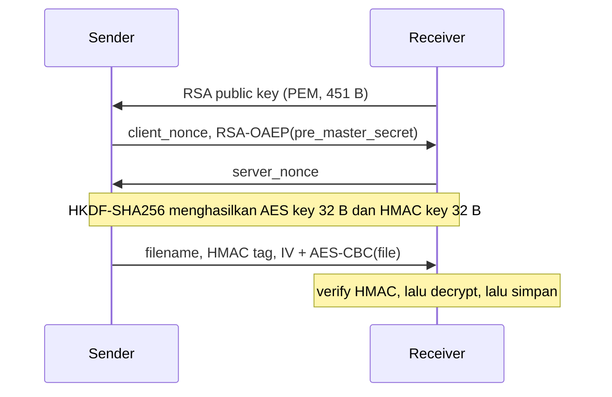

Frederiko Eldad Mugiyono
13523147
Naufarrel Zhafif Abhista
13523149
# Tugas
Encrypt file menggunakan AES, lalu verify *authenticity* / *integrity* memakai HMAC. File hasil encryption ditukar dengan partner, lalu partner memverifikasi, me-*decrypt*, dan memastikan hasilnya sama persis dengan original file.
Detail:
 1. Kelompok 2 orang
 2. Tools: Python + library cryptography
 3. Encryption: AES-256-CBC
 4. Verification: HMAC-SHA256 (dipilih HMAC)
 5. Test file: small.txt (1024 B) dan large.txt (10 MiB = 10.485.760 B)
## Script
AES merupakan symmetric encryption, artinya sender dan receiver harus memegang key yang sama. Masalahnya, key tersebut tidak boleh dikirim secara plaintext lewat network (*key distribution problem*). Kami menanganinya dengan menambahkan *handshake* RSA di awal TCP connection. RSA hanya bertugas mengirim *secret* awal (pre_master_secret) secara aman, bukan untuk encrypt file payload. Dari *secret* tersebut, kedua sisi me-*derive* *session key* secara independen via HKDF, baru kemudian file diproses dengan AES.
Alur program (crypto_tool.py, mode listen dan send):
 1. *Receiver* (listen) me-*load* atau me-*generate* RSA-2048 keypair (rsakey.pem, rsakey.pub), membuka TCP listener di port 9000, lalu langsung mengirim *public key*-nya ke sender begitu connection terbuka.
 2. *Sender* (send) membuat client_nonce (32 B) dan pre_master_secret (32 B), lalu encrypt *pre-master secret* memakai RSA-OAEP-SHA256 menggunakan *public key* milik receiver.
 3. *Receiver* decrypt *pre-master secret* menggunakan *private key*-nya, lalu membalas dengan server_nonce (32 B).
 4. Kedua sisi menjalankan HKDF-SHA256 dengan parameter salt = client_nonce || server_nonce untuk derive data 64 B: 32 B pertama menjadi **AES key**, dan 32 B berikutnya menjadi **HMAC key**.
 5. *Sender* encrypt data file memakai AES-256-CBC (random IV 16 B, PKCS7 padding), lalu compute HMAC-SHA256 atas IV || ciphertext (*encrypt-then-MAC*). Data yang dikirim mencakup filename, HMAC tag, serta IV || ciphertext.
 6. *Receiver* **verify HMAC tag terlebih dahulu** sebelum memanggil fungsi decryption. Bila tag invalid, execution langsung drop dengan InvalidSignature tanpa menulis file ke storage. Jika valid, file di-decrypt dan disimpan sebagai received_<nama file>.

```python
import os, sys, traceback, struct, socket
from pathlib import Path
from cryptography.hazmat.primitives.asymmetric import rsa, padding as asym_padding
from cryptography.hazmat.primitives.ciphers import Cipher, algorithms, modes
from cryptography.hazmat.primitives import padding, hmac, hashes, serialization
from cryptography.hazmat.primitives.kdf.hkdf import HKDF
KEY_FILE = "rsakey"
def log(verbose, tag, msg):
    if verbose:
        print(f"[{tag}] {msg}")
def _hex(data, limit=32):
    h = data.hex()
    if len(data) > limit:
        return f"{h[:limit*2]}... ({len(data)} bytes)"
    return f"{h} ({len(data)} bytes)"
def load_or_create_key(base_name = KEY_FILE, verbose=False):
    priv_path = Path(f"{base_name}.pem")
    pub_path = Path(f"{base_name}.pub")
    if priv_path.exists():
        private_key = serialization.load_pem_private_key(
            priv_path.read_bytes(),
            password=None
        )
        log(verbose, "KEY", f"Loaded existing keypair from {priv_path}")
        return private_key, private_key.public_key()
    log(verbose, "KEY", "No existing key found, generating new RSA-2048 keypair...")
    private_key = rsa.generate_private_key(
        public_exponent=65537,
        key_size=2048,
    )
    public_key = private_key.public_key()
    priv_path.write_bytes(
        private_key.private_bytes(
            encoding=serialization.Encoding.PEM,
            format=serialization.PrivateFormat.TraditionalOpenSSL,
            encryption_algorithm=serialization.NoEncryption()
        )
    )
    pub_path.write_bytes(
        public_key.public_bytes(
            encoding=serialization.Encoding.PEM,
            format=serialization.PublicFormat.SubjectPublicKeyInfo,
        )
    )
    log(verbose, "KEY", f"Saved new keypair to {priv_path} / {pub_path}")
    return private_key, public_key
def client_handshake(pub_key, verbose=False):
    nonce = os.urandom(32)
    pre_master_secret = os.urandom(32)
    log(verbose, "HANDSHAKE", f"Generated client nonce: {_hex(nonce)}")
    log(verbose, "HANDSHAKE", f"Generated pre-master secret: {_hex(pre_master_secret)}")
    encrypted_pms = pub_key.encrypt(
        pre_master_secret,
        asym_padding.OAEP(
            mgf=asym_padding.MGF1(algorithm=hashes.SHA256()),
            algorithm=hashes.SHA256(),
            label=None,
        )
    )
    log(verbose, "HANDSHAKE", f"Encrypted pre-master secret with server's RSA public key (OAEP-SHA256): {_hex(encrypted_pms)}")
    return nonce, encrypted_pms, pre_master_secret
def server_handshake(priv_key, encrypted_pms, verbose=False):
    s_nonce = os.urandom(32)
    log(verbose, "HANDSHAKE", f"Generated server nonce: {_hex(s_nonce)}")
    pre_master_secret = priv_key.decrypt(
        encrypted_pms,
        asym_padding.OAEP(
            mgf=asym_padding.MGF1(algorithm=hashes.SHA256()),
            algorithm=hashes.SHA256(),
            label=None,
        ),
    )
    log(verbose, "HANDSHAKE", f"Decrypted pre-master secret with RSA private key (OAEP-SHA256): {_hex(pre_master_secret)}")
    return s_nonce, pre_master_secret
def derive_session_keys(pre_master_secret, client_nonce, server_nonce, verbose=False):
    salt = client_nonce + server_nonce
    log(verbose, "KDF", f"salt = client_nonce || server_nonce: {_hex(salt)}")
    hkdf = HKDF(
        algorithm=hashes.SHA256(),
        length=64,
        salt=salt,
        info=b"ambatukam",
    )
    derived = hkdf.derive(pre_master_secret)
    aes_key = derived[:32]
    hmac_key = derived[32:]
    log(verbose, "KDF", "HKDF-SHA256(pre_master_secret, salt, info=b'ambatukam') -> 64 bytes")
    log(verbose, "KDF", f"AES key: {_hex(aes_key)}")
    log(verbose, "KDF", f"HMAC key: {_hex(hmac_key)}")
    return aes_key, hmac_key
def aes_encrypt(aes_key, data, verbose=False):
    iv = os.urandom(16)
    log(verbose, "AES", f"Encrypting {len(data)} bytes of plaintext, IV: {_hex(iv)}")
    padder = padding.PKCS7(128).padder()
    padded = padder.update(data) + padder.finalize()
    enc = Cipher(algorithms.AES(aes_key), modes.CBC(iv)).encryptor()
    ciphertext = enc.update(padded) + enc.finalize()
    log(verbose, "AES", f"PKCS7-padded to {len(padded)} bytes, AES-256-CBC ciphertext: {_hex(ciphertext)}")
    return iv + ciphertext
def aes_decrypt(aes_key, blob, verbose=False):
    iv, ct = blob[:16], blob[16:]
    log(verbose, "AES", f"Decrypting {len(ct)} bytes of ciphertext, IV: {_hex(iv)}")
    dec = Cipher(algorithms.AES(aes_key), modes.CBC(iv)).decryptor()
    padded = dec.update(ct) + dec.finalize()
    unpadder = padding.PKCS7(128).unpadder()
    plaintext = unpadder.update(padded) + unpadder.finalize()
    log(verbose, "AES", f"Decrypted and unpadded to {len(plaintext)} bytes of plaintext")
    return plaintext
def sign(hmac_key, data, verbose=False):
    h = hmac.HMAC(hmac_key, hashes.SHA256())
    h.update(data)
    tag = h.finalize()
    log(verbose, "HMAC", f"Signed {len(data)} bytes of ciphertext -> tag: {_hex(tag)}")
    return tag
def verify(hmac_key, data, tag, verbose=False):
    h = hmac.HMAC(hmac_key, hashes.SHA256())
    h.update(data)
    log(verbose, "HMAC", f"Verifying tag {_hex(tag)} over {len(data)} bytes of ciphertext...")
    h.verify(tag)
    log(verbose, "HMAC", "Tag valid.")
def send_msg(sock, data):
    sock.sendall(struct.pack("!I", len(data)) + data)
def recv_msg(sock):
    raw_len = recv_exact(sock, 4)
    if not raw_len:
        return b""
    msg_len = struct.unpack("!I", raw_len)[0]
    return recv_exact(sock, msg_len)
def recv_exact(sock, n):
    buf = bytearray()
    while len(buf) < n:
        chunk = sock.recv(n - len(buf))
        if not chunk:
            raise ConnectionResetError("Socket closed prematurely")
        buf.extend(chunk)
    return bytes(buf)
def listen_for_files(port = 9000, save_dir = ".", verbose=False):
    priv_key, pub_key = load_or_create_key(verbose=verbose)
    pub_bytes = pub_key.public_bytes(
        encoding=serialization.Encoding.PEM,
        format=serialization.PublicFormat.SubjectPublicKeyInfo,
    )
    server = socket.socket(socket.AF_INET, socket.SOCK_STREAM)
    server.setsockopt(socket.SOL_SOCKET, socket.SO_REUSEADDR, 1)
    server.bind(("0.0.0.0", port))
    server.listen(5)
    print(f"[*] Server listening on 0.0.0.0:{port}")
    while True:
        conn, addr = server.accept()
        print(f"[+] Incoming connection from {addr}")
        try:
            # 1. SEND OUR PUBLIC KEY TO SENDER IMMEDIATELY
            send_msg(conn, pub_bytes)
            log(verbose, "NET", f"Sent our public key ({len(pub_bytes)} bytes)")
            # 2. Handshake exchange
            c_nonce = recv_exact(conn, 32)
            log(verbose, "NET", f"Received client nonce: {_hex(c_nonce)}")
            enc_pms = recv_msg(conn)
            log(verbose, "NET", f"Received encrypted pre-master secret ({len(enc_pms)} bytes)")
            s_nonce, pms = server_handshake(priv_key, enc_pms, verbose=verbose)
            conn.sendall(s_nonce)
            log(verbose, "NET", "Sent server nonce")
            aes_key, hmac_key = derive_session_keys(pms, c_nonce, s_nonce, verbose=verbose)
            # 3. Receive encrypted file
            filename = recv_msg(conn).decode("utf-8")
            log(verbose, "NET", f"Receiving file: {filename}")
            tag = recv_exact(conn, 32)
            ciphertext = recv_msg(conn)
            log(verbose, "NET", f"Received ciphertext ({len(ciphertext)} bytes) and HMAC tag")
            verify(hmac_key, ciphertext, tag, verbose=verbose)
            plaintext = aes_decrypt(aes_key, ciphertext, verbose=verbose)
            out_path = Path(save_dir) / f"received_{filename}"
            out_path.write_bytes(plaintext)
            print(f"[✓] Successfully received: {out_path.name}")
        except Exception:
            traceback.print_exc()
        finally:
            conn.close()
def send_file(target_ip, target_port, filepath, verbose=False):
    path = Path(filepath)
    if not path.exists():
        raise FileNotFoundError(f"File not found: {filepath}")
    sock = socket.socket(socket.AF_INET, socket.SOCK_STREAM)
    sock.connect((target_ip, target_port))
    print(f"[*] Connected to {target_ip}:{target_port}")
    try:
        # 1. RECEIVE THE RECEIVER'S PUBLIC KEY OVER THE WIRE
        raw_pub = recv_msg(sock)
        log(verbose, "NET", f"Received remote public key ({len(raw_pub)} bytes)")
        remote_pub = serialization.load_pem_public_key(raw_pub)
        # 2. Handshake using that key
        c_nonce, enc_pms, pms = client_handshake(remote_pub, verbose=verbose)
        sock.sendall(c_nonce)
        log(verbose, "NET", "Sent client nonce")
        send_msg(sock, enc_pms)
        log(verbose, "NET", f"Sent encrypted pre-master secret ({len(enc_pms)} bytes)")
        s_nonce = recv_exact(sock, 32)
        log(verbose, "NET", f"Received server nonce: {_hex(s_nonce)}")
        aes_key, hmac_key = derive_session_keys(pms, c_nonce, s_nonce, verbose=verbose)
        # 3. Encrypt and transmit file
        file_bytes = path.read_bytes()
        log(verbose, "FILE", f"Read {len(file_bytes)} bytes from {path}")
        ciphertext = aes_encrypt(aes_key, file_bytes, verbose=verbose)
        tag = sign(hmac_key, ciphertext, verbose=verbose)
        send_msg(sock, path.name.encode("utf-8"))
        sock.sendall(tag)
        send_msg(sock, ciphertext)
        log(verbose, "NET", f"Sent filename, HMAC tag, and ciphertext ({len(ciphertext)} bytes)")
        print(f"[✓] Successfully sent {path.name}")
    finally:
        sock.close()
if __name__ == "__main__":
    args = sys.argv[1:]
    verbose = False
    for flag in ("-v", "--verbose"):
        if flag in args:
            verbose = True
            args.remove(flag)
    if len(args) < 1:
        print("Usage:")
        print("  Listen: python node.py listen [port] [-v]")
        print("  Send:   python node.py send <target_ip> <target_port> <filepath> [-v]")
        sys.exit(1)
    cmd = args[0]
    if cmd == "listen":
        port = int(args[1]) if len(args) > 1 else 9000
        listen_for_files(port, verbose=verbose)
    elif cmd == "send":
        target_ip = args[1]
        target_port = int(args[2])
        target_file = args[3]
        send_file(target_ip, target_port, target_file, verbose=verbose)
```
Cara run:
```sh
# receiver
python crypto_tool.py listen 9000 -v
# sender
python crypto_tool.py send <ip_receiver> 9000 small.txt -v
python crypto_tool.py send <ip_receiver> 9000 large.txt -v
```
Fitur *verbose logging* (flag -v, fungsi log() dan _hex(), serta baris logging di setiap step kriptografi) dibuat dengan bantuan AI untuk mempermudah visualisasi pipeline. Core logic kriptografinya (RSA-OAEP, HKDF, AES-CBC, HMAC) sepenuhnya decoupled dari fitur ini; flag -v murni digunakan untuk print *intermediate values* pada console.
File uji di-generate memakai script gen_files.py (string berulang aku ganteng):
```python
s = "aku ganteng"
def make(path, size):
    with open(path, "wb") as f:
        f.write((s * (size // len(s) + 1))[:size].encode())
make("small.txt", 1024)
make("large.txt", 10 * 1024 * 1024)
```
## Hasil
Testing dilakukan dengan *receiver* (listen 8080) di 10.5.102.126 dan *sender* (send) dari 10.50.16.119. Pengujian mencakup transfer file small.txt (2 kali) serta large.txt (1 kali).
Output terminal *sender*, small.txt:
```
[*] Connected to 10.5.102.126:8080
[NET] Received remote public key (451 bytes)
[HANDSHAKE] Generated client nonce: e7442bedbf4e0d660c5684b318a79bf2f68fef49a3d9e01c1870a9cdd8108de6 (32 bytes)
[HANDSHAKE] Generated pre-master secret: 6c575af88a488662bcd925de8d95e60218c61f58057192fb60eb0a24ae851a85 (32 bytes)
[HANDSHAKE] Encrypted pre-master secret with server's RSA public key (OAEP-SHA256): 88bdcb2994f3c20ae49111b0617182fad94f07326b1aad80b4242ffe1529c2f1... (256 bytes)
[NET] Sent client nonce
[NET] Sent encrypted pre-master secret (256 bytes)
[NET] Received server nonce: cdc162dd2a21bade287cd5a050e66d4b93529494a3c0e748f5842905cfa9c85d (32 bytes)
[KDF] salt = client_nonce || server_nonce: e7442bedbf4e0d660c5684b318a79bf2f68fef49a3d9e01c1870a9cdd8108de6... (64 bytes)
[KDF] HKDF-SHA256(pre_master_secret, salt, info=b'ambatukam') -> 64 bytes
[KDF] AES key: 92353258e340a2c1cb8bab0ed470d973321c4caa0da0a683fe7030438145c192 (32 bytes)
[KDF] HMAC key: a1bea2648aedd30ea7c17163afea045152d23011bb4e1f974c251585462685b1 (32 bytes)
[FILE] Read 1024 bytes from small.txt
[AES] Encrypting 1024 bytes of plaintext, IV: fc37f4f01881638718740d6b5a5027f7 (16 bytes)
[AES] PKCS7-padded to 1040 bytes, AES-256-CBC ciphertext: 04757fa6e42078feb1ad043749e5a4e058c1ba593156661a85a5ede4dc2ee8e3... (1040 bytes)
[HMAC] Signed 1056 bytes of ciphertext -> tag: ca9ca516d3ef338e3e9dc59c2ec953a59da490bc836769c0dddde8bee11b9f39 (32 bytes)
[NET] Sent filename, HMAC tag, and ciphertext (1056 bytes)
[✓] Successfully sent small.txt
```
Output terminal *sender*, large.txt (*handshake* sama, hanya menampilkan log proses file):
```
[KDF] AES key: 15da2f09d9cc94a2779d686381b3d46daf95ff6ade01da98f7d5086025b9a362 (32 bytes)
[KDF] HMAC key: edc191dab909c19a98f205019c0a52b3081551561cb2230d197c606f4002ed3f (32 bytes)
[FILE] Read 10485760 bytes from large.txt
[AES] Encrypting 10485760 bytes of plaintext, IV: b0a016281f8058f2c65c790671425116 (16 bytes)
[AES] PKCS7-padded to 10485776 bytes, AES-256-CBC ciphertext: cb8318b75dbb9a1b04bef656c6bb44cd9df490d04640642264242cee2bd279fa... (10485776 bytes)
[HMAC] Signed 10485792 bytes of ciphertext -> tag: 828001c67cc602028603c29c46c0fd144f817a23027cc2f8493001a1c8164cd8 (32 bytes)
[NET] Sent filename, HMAC tag, and ciphertext (10485792 bytes)
[✓] Successfully sent large.txt
```
Output terminal *receiver* (dijalankan tanpa -v):
```
[*] Server listening on 0.0.0.0:8080
[+] Incoming connection from ('10.50.16.119', 33604)
[✓] Successfully received: received_small.txt
[+] Incoming connection from ('10.50.16.119', 49022)
[✓] Successfully received: received_small.txt
[+] Incoming connection from ('10.50.16.119', 56024)
[✓] Successfully received: received_large.txt
```
Log [✓] Successfully received hanya muncul bila verification HMAC valid, decryption CBC selesai tanpa error padding, dan file sukses ditulis ke disk. Untuk memastikan hasil decrypt tidak corrupt, kami melakukan hashing SHA-256 pada original file dan decrypted file di receiver:
```sh
$ sha256sum large.txt received_large.txt
00ffb6a24ee1d11d6046f00925ca698d0b3dc318723e1448f031a76e9cf2c9c3  large.txt
00ffb6a24ee1d11d6046f00925ca698d0b3dc318723e1448f031a76e9cf2c9c3  received_large.txt
$ sha256sum small.txt received_small.txt
cb987f856a7d735cbac9a6c55a33f14e522231b009c4bd23fc6ec1d98063f246  small.txt
cb987f856a7d735cbac9a6c55a33f14e522231b009c4bd23fc6ec1d98063f246  received_small.txt
```
Checksum SHA-256 identik pada kedua pasang file, membuktikan integrity file terjaga utuh tanpa ada modifikasi atau bit corruption.
# Kesimpulan
## Ringkasan
Problem distribusi key pada symmetric cipher diselesaikan via *key exchange* sederhana memakai RSA-OAEP. Kunci AES dan HMAC tidak pernah dikirim dalam bentuk plaintext lewat network, melainkan di-derive secara lokal lewat HKDF dari pre_master_secret dan nonce. Pipeline encryption AES-256-CBC yang dipadukan dengan HMAC-SHA256 (*encrypt-then-MAC*) berjalan konsisten untuk payload file 1 KiB maupun 10 MiB.
## Tabel Hasil Uji

| File | Ukuran Original | Ukuran Ciphertext | Breakdown Overhead | Ukuran Tag HMAC | SHA-256 Match |
| :--- | :--- | :--- | :--- | :--- | :--- |
| small.txt | 1.024 B | 1.056 B | 1.024 + PKCS7 padding 16 B + IV 16 B | 32 B | Ya |
| large.txt | 10.485.760 B | 10.485.792 B | 10.485.760 + PKCS7 padding 16 B + IV 16 B | 32 B | Ya | <br> ## Analisis & Temuan <br> * Ukuran ciphertext selalu bertambah persis 32 B dari plaintext aslinya (16 B alokasi random IV + 16 B PKCS7 padding). Karena aturan PKCS7 selalu menyematkan padding meskipun panjang payload sudah merupakan kelipatan block size cipher (16 B), file 1.024 B dan 10.485.760 B tetap mendapat ekspansi dummy 1 block penuh (16 B). <br> * HMAC dihitung langsung atas blob IV || ciphertext. Ini memungkinkan receiver me-verify keaslian dan integrity payload sebelum decryptor dieksekusi, sehingga kebal dari serangan *padding oracle attack*.

 * Separasi key terjaga karena HKDF menurunkan dua key yang independen dari master entropy yang sama (AES key dan HMAC key terpisah), menghindari vulnerability akibat pemakaian satu key untuk dua algoritma berbeda.
 * Parameter nonce acak memastikan setiap TCP connection menghasilkan session key yang unik. Mekanisme ini otomatis menangkal *replay attack*, sebab rekaman transmisi lama yang dikirim ulang akan gagal di-verify akibat *server_nonce* yang tidak match.
 * File 10 MiB masih aman diproses secara *in-memory buffer* (read_bytes()). Namun untuk menangani file skala gigabyte (GB), implementasi perlu diubah ke model *chunked streaming* agar tidak terjadi RAM exhaustion.
## Catatan Keamanan
 * Public key milik receiver dikirim secara plaintext tanpa verifikasi certificate atau mekanisme *fingerprint pin*, sehingga rentan terhadap skenario *Man-in-the-Middle* (MITM). Active attacker di network bisa mengintersepsi dan mengganti public key tersebut dengan key miliknya. Solusi praktisnya adalah me-verify fingerprint rsakey.pub lewat *out-of-band channel* sebelum transmisi.
 * HMAC berbasis pada shared symmetric key, sehingga jaminan yang diberikan sebatas *authenticity* dan *integrity*, bukan *non-repudiation*. Kedua pihak sama-sama bisa membuat tag yang valid. Jika dibutuhkan bukti identitas sender secara absolut, sistem harus mengimplementasikan asymmetric *digital signature* (seperti RSA-PSS atau Ed25519).
 * Nilai filename dikirim di luar scope perhitungan HMAC. Akibatnya, *on-path attacker* bisa memodifikasi filename di tengah jalan. Walaupun risiko *path traversal* teredam berkat prefix received_, filename idealnya disanitasi via Path(filename).name dan dimasukkan ke dalam payload yang di-MAC.
 * Desain ini belum mengimplementasikan *forward secrecy*. Kerahasiaan seluruh session lampau bergantung penuh pada static *private key* RSA. Jika rsakey.pem bocor di kemudian hari, seluruh *pre-master secret* yang pernah terekam dapat di-decrypt. Penggunaan *ephemeral key exchange* (seperti ECDHE) diperlukan untuk menutup risiko ini.
 * Skema manual AES-CBC + HMAC menuntut urutan *encrypt-then-MAC* dan komparasi *constant-time* yang ketat. Penggunaan mode *Authenticated Encryption with Associated Data* (AEAD) seperti AES-GCM atau ChaCha20-Poly1305 lebih disarankan karena sudah terintegrasi dalam satu primitif dan mengurangi kompleksitas implementasi.
 * Flag -v menulis AES key dan HMAC key langsung ke terminal. Fitur ini hanya untuk keperluan demo tugas dan wajib dimatikan di production environment.
 * Private key rsakey.pem disimpan tanpa proteksi passphrase (NoEncryption()), sehingga keamanannya bergantung penuh pada *file permission* di operating system.