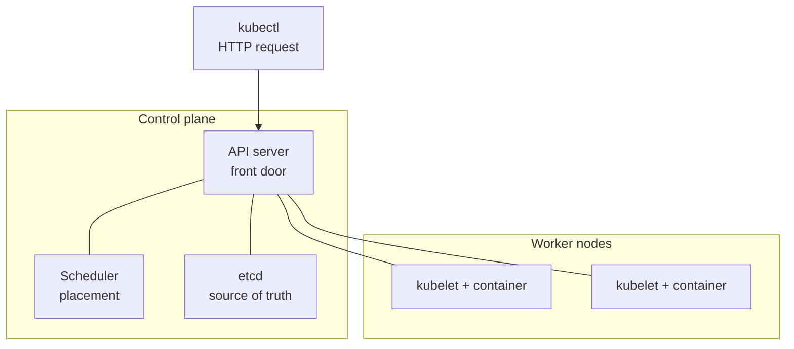
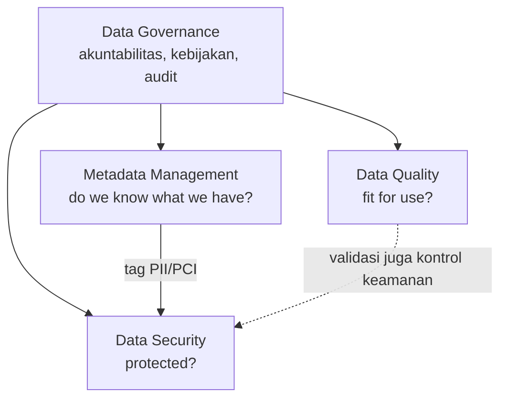
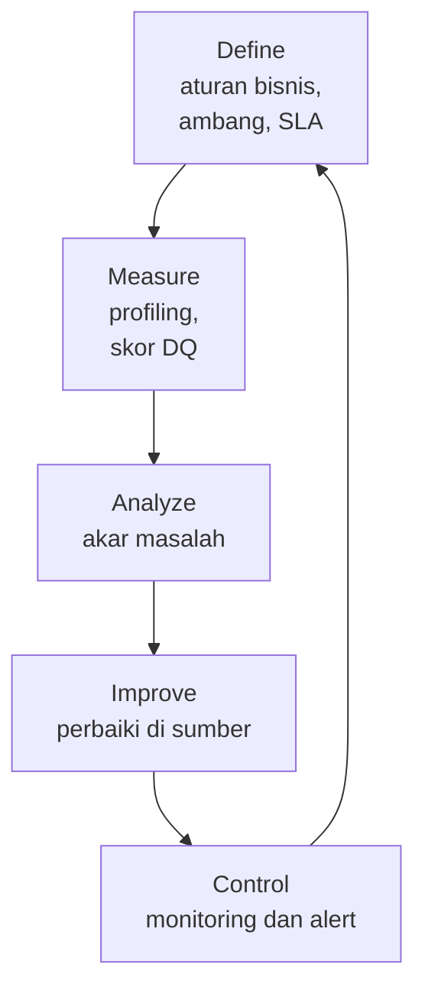
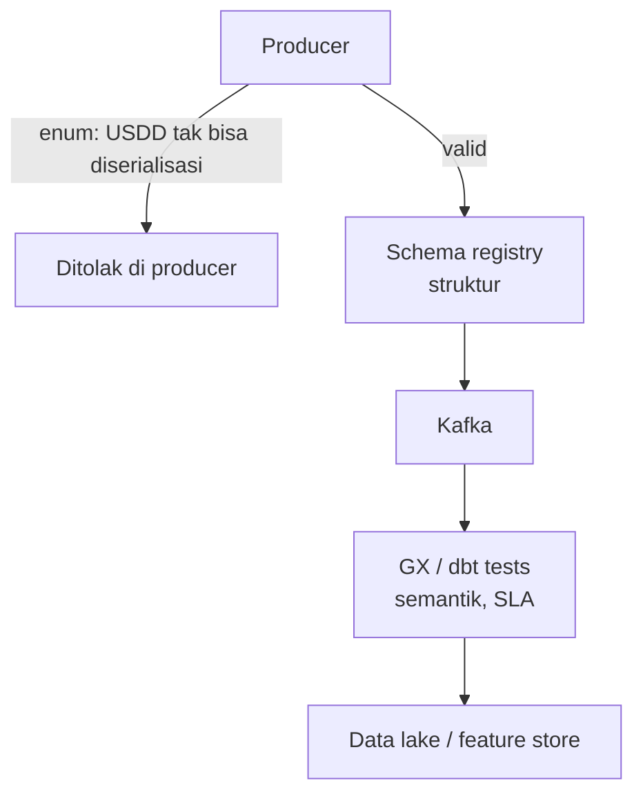

### DevOps
2 tujuan utama xops:
1. membangun enterprise stack yang terotomasi dan mengurangi duplikasi
2. memungkinkan operasionalisasi sejak awal
operasional -> pendekatan sistematis untuk otomasi

Best practice:
1. Agility
2. Automation
3. Inegrted configuring
4. monitoring

Tools -> COntaineriation, CI/CD, monitoring, cloud
fields -> DevOps, DataOps, MLOps

Anti-pattern
- deploy manual
- deploy ke prod-like env after done dev
- manual config of prod

8 principle delivery
1. Repeatable
2. Automate
3. Version Control
4. Hurts => More frequent
5. build quality
6. done = RELEASED
7. everybody is reponsible
8. continous improvement

Siklus DevOps
Discover -> Plan -> Build -> Test -> deploy -> Operate -> Observe -> Continous Feedback

Siklus MLOps
Data Gathering -> Model Dev -> Validation -> Deployment & Serving -> Monitoring
Maturity level: 0 (Manual), 1 (Training pakai pipeline), 2 (Pipeline otomatis ci/cd)

DataOps -> Kumpulan praktik pengelolaan data yng terintefrasi dan process oriented
Tugas: Planning -> Dev -> Test -> Deploy -> Ops -> Feedback

Intinya Xops -> Otomasi, Versioning, Testing, Monitoring
_plan → build → test → release → operate → monitor → feedback_.

Dipakai buat app cloud native, yang mana karakteristik cloud native:
1. Microservice
2. Containerization
3. Devops-Automation
4. Dynamic Orchestration

Heroku ngasih 12 faktor buat app SAAS
1. Codebase
2. Dependencies
3. Config
4. Backing Services
5. B -> R -> R
6. Processes
7. Port Binding
8. COncurrecny
9. Disposability
10. Dev/Prod Parity
11. Logs
12. ADmin Process


**Microservices** memecah satu aplikasi besar menjadi layanan yang **dapat di-deploy mandiri**, masing-masing memiliki sepotong sempit business capability.

Pattern buat microservices:
1. Decompose by Business Capability
2. API Gateway

Git -> Version Control
Docker -> Buat containerization, dibikin pakai Dockerfile -> Declarative recipe
Compose -> Reproducible Env
MinIo -> Object store with S3 API

all these for Scaffold & Containerize

### CI
merge code ke shared trunk secara sering (beberapa kali SEHARI). merge = automatic build and testing

buat pipeline CI, bikin shift left: seurity guardrial dipasang semakin kiri (semakin awal) di alur kerja
code: IDE Lint, pre-commit hook
commit: unit test; SAST
build: compile ,dependecy scan
pkg: container scan, artifact signing
deploy: policy check

principle

1. Fail Fast, Fail Loud
2. Immutable Artifacts
3. Fast Feedbacks LOOps
4. TBD

testingnya pakai pyramid

Contract Test (Panggilan API) -> Integration Test (Real dependency) -> Unit Tests (Isolated)
jangan ice cream cone cok, usahain healthy pyramid

Lint -> unit -> SAST -> Build -> SCA -> Image -> Publish
flake8 -> pytest -> sonarqube -> docker build -> trivy -> docker push

yang di cek di SCA: base OS, runtime layer, OS pkg, aop dependency, app code

jalan sebelum di push ke registry. 

best practice:
1. registry cumam nyimpen output build, gabisa ada env yg narik image dari selain registry
2. ditandain per versi, bukan latest
3. pasang rule yang pushh dan pull, build ga boleh deploy ke prod
4. kalo ada retention and promotioin, mempermudah log auditting
   
Supply-chain Levels for Software Artifacts (SLSA) -> adalah kerangka level integritas build yang meningkat. Intinya: **membuktikan** bahwa artefak dibangun oleh proses tepercaya yang tahan manipulasi, bukan sekadar memindai kode sekali. 

- **Code quality gate** — lint dan unit test lolos lebih dulu.
- **Static analysis gate** — SAST bersih dari temuan Critical/High.
- **Dependency gate** — SCA bersih dari CVE Critical/High yang diketahui.
- **Container gate** — image scan bersih sebelum push ke registr

tooling CI, umumnya pakai gitlab CI. bisa bikin pipeline as code with .gitlab-ci.yml
bikin per stages (lint, test, scan, build, deploy). bs juga gh action, tapi dia workflow based. ya mirip
si sebenernya

**Trivy** itu spesialis _Infrastructure & Dependency Security_ (SCA + IaC/Container), sedangkan **SonarQube** itu spesialis _Source Code Quality & Security_ (SAST).

ANTI PATTERN GITOPS
1. alert fatigue -> low kebanyakan muncul, jadinya malah dbiarin
2. flaky test -> kadang gagal kadang sukses
3. mutable latest tag -> pake latest tag (padahal in berubah2 tiap push)
4. secret ke LOG

### IAC
define infrastruktur via file BIAR bisa dilacak di version control
safenya pakai deklaratif (define final state) instead of imperatif (via sh/script)

Pola umum: **resource graph, modules, environments as data, dan state**. Begitu container banyak, **orchestrator** seperti Kubernetes menangani scheduling, scaling, networking, dan self-healing secara deklaratif.

kita pengen IAC:
1. idempoten! jalanin 2 kali, hasil identik.
2. immutable: kalau mau ganti, ganti dari filenya. menghindari config drift

alatnya pakai Terraform
1. Write HCL (**HashiCorp Configuration Language**)
2. terraform plan; terraform diff
3. review pr
4. terraform apply

source of truth via state file tf  -> simpen di db prod




API server jd tempat terhubung semua node, ada scheduler, ada etcd (db nya kubernetes, state config metadata). basically kubectl = http request

objek di kube ada pod (1 stable container), deployment (n replicas pod), service (akses via jaringan, ngasih clusterIP)

kind vs minikube

|**Fitur / Aspek**|**kind (Kubernetes in Docker)**|**Minikube**|
|---|---|---|
|**Arsitektur Utama**|Menggunakan **Docker Container sebagai Node**. Node K8s berjalan di atas kontainer Docker.|Menggunakan **Virtual Machine (VM)** atau Docker Container/Hypervisor (VirtualBox, QEMU, Hyper-V, Docker).|
|**Kecepatan Startup**|**Sangat cepat** (beberapa detik aja) karena cuma nge-spin up kontainer.|Lebih lambat karena butuh _booting_ OS VM penuh (kalau pake driver VM).|
|**Penggunaan Resource**|**Sangat ringan** RAM & CPU-nya.|Cenderung lebih makan RAM & CPU (terutama kalau pake driver VM).|
|**Multi-Node Cluster**|**Gampang banget** & _native_. Tinggal tambah baris konfigurasi YAML, bisa langsung punya 1 Control Plane + 3 Worker Nodes di laptop.|Bisa multi-node, tapi lebih berat dan agak _tricky_ pengaturannya.|
|**Fitur Built-in**|Minimalis/polosan (cocok buat testing CI/CD pipeline).|Punya banyak _addons_ bawaan (Dashboard, Metrics Server, Ingress, Registry) tinggal `minikube addons enable`.|
|**Penggunaan Utama**|**CI/CD Pipeline**, _automated testing_, & testing lokal multi-node.|**Belajar/Latihan K8s lokal**, _trial/error_ fitur K8s dengan _addons_ instan.|

- **Pakai `kind` kalau** kamu mau bikin skrip testing otomatis di CI/CD pipeline (GitHub Actions/GitLab CI), atau mau simulasi skenario cluster multi-node (misal: _node affinity, pod anti-affinity, failover_) di laptop tanpa bikin berat.
- **Pakai `Minikube` kalau** kamu lagi awal-awal belajar Kubernetes di laptop dan butuh fitur-fitur instan kaya Dashboard UI atau butuh akses _tunnel/ingress_ cepat tanpa ribet ngatur config manual

kube pake RBAC buat authorization
Role; RoleBinding <-> ClusterRole, ClusterRoleBinding

pod cuma boleh jalan nonroot and least privilege

tambahin admisiion controller setelah authn authz, tp sblm di simpen <- disini ada policy enforcementt
umum pakai Kyverno, policy ditulis dengan YAML. bisa validate, mutate, generate


### Release Engineering
Fokus pada pengiriman kode secara aman
- pemisahaan build test release
- fast without sacrificing stability
- release pipeline as product

Setiap deployment membawa risiko. **Blast radius** adalah **jumlah pengguna atau sistem yang terdampak** bila deployment gagal. Tujuan Release Engineering: meminimalkan blast radius dan **time-to-recovery (MTTR)**.

evolution: big bang -> rolling update -> blue green -> canary

rolling: ganti pod. jelek buat yang db nya ga backward compatible. dua kode jg jalan barengan
blue-green: bikin 2 env, blue (baru) dan green. pindahinnya di router/load balancer
canary: pasang persen di blue. kalau sehat by metrik naikin pelan2
bisa diotomasi berdasarkan telemetry, namanya progressive delivery

decoupling deployment sama release. deploy teknikal, release bisnis. bisa pakai feature flag. kode bisa aja
udah di deploy, cuma fiturnya blm aktif (belum release, belum ke ekspos ke pengguna)

kalau butuh rollback, BLAMELESS dan WITHOUT FRICTION
rollback kelamaan, jelek berarti, max 30 menit

kita pakai GitOps buat ini: SSOT buat declarative infra and apps. ga perlu kubectl apply -f
kalo mau change di prod, pake commit dan PR

4 prinsip gitops:
1. declarative
2. versioned and immutable
3. pulled automatically
4. continusly reconciled

push: CI Server -> Cluster (with kubectl)
pull: CI Server -> GIt Repo <- di pull argoCD -> push ke cluster

bagusan pull; push butuh credential, push butuh destination jelas (CGNat nahan push), drift detection lebih clear karena modelnya agent mantau diff cluster terus

helm: pkg manager buat Kube. manifest -> chart, supports templating (reusable dengan go templates)
argocd: tool delivery gitops. jalan dalam cluster, mantau repo, sync state cluster. ada ui buat visualize drift and topologi

mekanisme:
1. Git dibandingin sama actual state
2. Kalau ada drift, berarti keduanya udah beda
3. Dikoreksi Argocd berdasarkan git (SSOT). atau alert

ada sync policy:
1. manual: ngasih alert, nunggu acc
2. otomatis/prune & self-heal: lgsg koreksi

kalo debug, yang self heal bisa bikin lost track

DevSecOps pada Pipeline Release
- **Image signing** — Cosign/Notary agar hanya image bertanda tangan yang di-deploy.
- **Manifest scanning** — kube-score atau Polaris memindai Helm chart sebelum mencapai cluster.
- **RBAC** — ArgoCD hanya berizin deploy ke namespace tertentu.
- **Secret management** — jangan commit secret mentah ke Git; pakai External Secrets Operator, Sealed Secrets, atau Vault.
- **PR approvals** — wajibkan peer review untuk semua perubahan manifest di Git.

best practice:
1. immutable artifacts
2. git for SSOT
3. rollback based on metrics

anti pattern:
1. snowflake cluster
2. push based gitops
3. big bang FRIDAYYY
4. canary without metrics

### DataOps
Dataops -> dipake tim analitik dan data dalam peninkatan kualitan dan cycle time analitik

| Aspek | DevOps | DataOps |
|---|---|---|
| Artefak utama | Kode (stateless) | Data + kode (stateful) |
| Fokus testing | Unit, integration, E2E | Data quality, schema, anomaly detection |
| Dampak kegagalan | Outage, bug | "Garbage in, garbage out", model ML cacat |
| Version control | Git | Git + data versioning / schema registry |

| Kode | Data |
|---|---|
| Berubah saat deploy | Berubah kapan pun dunia berubah |
| Bug biasanya gagal keras | Bug sering gagal **diam-diam** |
| Tes deterministik | Input tak terbatas dan berantakan |
| Rollback = redeploy versi lama | Rollback = menulis ulang sejarah (sulit) |
| Satu tim pemilik | Producer dan consumer tim berbeda |

Prinsip DataOps
1. **Automation** — hapus penanganan data manual; otomasi ingestion, testing, deployment.
2. **CI/CD for data** — kode pipeline dan definisi skema melewati gate CI/CD seketat kode aplikasi.
3. **Observability** — pantau kesehatan pipeline **dan** kesehatan data (akurat, lengkap, segar).
4. **Collaboration** — runtuhkan silo antara data engineer, data scientist, dan pakar domain.

Cara Lama vs Cara DataOps

| Cara lama | Cara DataOps |
|---|---|
| Microservice menulis log JSON ke file lokal | Mem-publish event bertipe (Avro) ke broker (Kafka) |
| Skrip kustom data scientist men-scrape file | **Schema Registry** menegakkan kontrak otomatis |
| Skrip rusak diam-diam saat field baru muncul | Data disimpan immutable di data lake (MinIO) dengan observability |

| Kegagalan | Contoh |
|---|---|
| Data terlambat/hilang | Consumer mati, lake basi |
| Data duplikat | Replay setelah crash |
| Schema drift | Field di-rename di hulu |
| Nilai buruk | `total_amount` negatif |
| Data sensitif bocor | Email mentah di lake |

Cara alir data:
1. Batch -> Tunggu lengkap, bounded
2. Streaming -> kontinu, unbounded

Cara kirim data:
1. P2P -> REST API, coupling tight, gagal kalau consumer mati
2. Pub/Sub -> Message Broker, loose coupled, pesan disimpen kalau consumer mati

Fokus ke Kafka:
1. Topik -> Kategori/nama feed
2. Partition -> pecahan topic biar bisa paralel, immutable berurutan
3. Alokasi ke partisi via key
4. Ngirim pesan antar topic gabisa urut, bisanya antar partisi intra topic

harus ada key biar urutan partisi ga ilang

yang subscribe bisa kumpulan consumer, namanya consumer group.
setiap consumer nerima, dia bandingin offset (last read dari sebuah partisi)
sama topik yg di consume

 - **Committed offset** = "saya sudah memproses sampai sini"; **commit setelah side effect berhasil**.
 - **Retention** (waktu atau ukuran) membatasi seberapa jauh ke belakang replay dimungkinkan.
 - **Compaction** mempertahankan nilai terbaru per key.

Kafka vs RabbitMQ

| | Kafka | RabbitMQ |
|---|---|---|
| Model | Distributed log, pull | Broker dengan routing, push |
| Replay | Native (rewind offset) | Terbatas |
| Terbaik untuk | Event stream, data pipeline | Task queue, routing kompleks |

Pengirman pesan ada 3 jenis: at most once (commit kirim, rentan ilang), at least once (kirim commit, rentan duplikasi), exactly one (RIBET)

standarnya pakai at least once yang idempoten, didupe via event_id

```
[ Source System (Kafka / API) ]
              │
              ▼
    ┌──────────────────┐
    │   BRONZE LAYER   │  <-- Data Mentah (Apa adanya, kotor, duplikat, tidak diubah)
    └─────────┬────────┘
              │ (Dibersihin, di-deduplicate)
              ▼
    ┌──────────────────┐
    │   SILVER LAYER   │  <-- Data Bersih (Format rapi, siap di-join)
    └─────────┬────────┘
              │ (Di-agregasi, di-hitung metrik bisnisnya)
              ▼
    ┌──────────────────┐
    │    GOLD LAYER    │  <-- Data Siap Saji (Buat Dashboard / Tabel Laporan)
    └──────────────────┘
```

Data mentah di bronze layer DAN immutable. kalau mau ngubah, simpen hasilnya di silver (in another words, dibersihin = pindah layer)

tujuannya:
1. biar bisa reprocessing sesuai SOT
2. bisa diaudit, sesuai sm source
3. semuanya bisa di read only dulu

producer sama consumber beda tim. kontraknya harus sama biar ga ngerusak consumer. kita pake skema biar perubahan yg terjadi itu eksplisit dan bisa di-check.

ada 2: schema on write (pas insert) dan on read (pas query). lebih bagus on read

producer serialize data dengan chema ID. schema ID ini yang dipake consumer untuk ambil skema dari registri skema

**Data contract** = **schema + semantik + kepemilikan**: nama field, makna, tipe; wajib vs opsional; rentang nilai (mis. `amount > 0`); jaminan delivery dan ekspektasi freshness; klasifikasi PII per field. Ditegakkan **di sisi producer sebelum publish**.

dataops juga perlu shift left. masalahnya, data buruk mubgkin tetep bisa lolos

kita implement DLQ, tujuannya nyimpen topic/queue unprocessable. ntar dicoba konsumen, kalau gagal, dirutekan ke *-dlq.*

karakteristik

- **Commit offset sebelum menulis** → data hilang.
- **Lupa memberi key `order_id`** → urutan hilang.
- **Satu file kecil per event** → small-file problem.
- **Tanpa mode kompatibilitas pada subject** → kontrak tak terlindungi.
- **Retry tak terbatas pada pesan buruk** → partisi macet.

 ### Apa yang Berubah dari CSV?

| CSV (Minggu 5) | Hari ini |
|---|---|
| Manual, basi | **Kontinu** |
| Snapshot sekali | **Replayable** |
| Kolom implisit | **Diatur skema** |
| Salinan termutasi | **Mentah dan immutable** |


### DataOps SQP
Bad data cost:
- **Silent failures** — pipeline tidak crash, melainkan menghasilkan angka yang salah.
- **Compounding** — error di ingestion diwarisi setiap fitur dan model hilir; error data 1% di ingestion dapat menjadi **error model 30%** di hilir.
- **Garbage in, garbage out**, diperbesar oleh ML.
- **Persamaan reliabilitas: Reliability = Uptime x Data Quality.**
- **Uptime tidak cukup**: pipeline bisa 100% available namun tetap tidak andal. Contoh: feed dengan uptime 99,99% dan 5% kode mata uang tak valid tetap memiliki **tingkat record cacat 5%**.


| Area | Pertanyaan inti | Contoh PayLend |
|---|---|---|
| **Data Quality** | Layakkah dipakai? | `currency_code = "USDD"` tak valid; `transaction_id` datang dua kali |
| **Data Security** | Terlindungikah? | SSN ditokenisasi, kartu menjadi 4 digit terakhir, masking per role |
| **Metadata Management** | Tahukah kita apa yang kita punya? | `ssn` ditag PII, `credit_card_num` ditag PCI di katalog |
| **Data Governance** | Siapa yang akuntabel? | Pemilik kontrak transaksi; siapa yang menyetujui akses ke token |




 DMBOK Data Quality Lifecycle



- **Define**: aturan bisnis, ambang batas, SLA.
- **Measure**: profiling data, hitung skor DQ.
- **Analyze**: cari akar masalah (producer hulu? bug transformasi?).
- **Improve**: perbaiki **di sumber** (diutamakan) atau lewat transformasi.
- **Control**: monitoring dan alerting kontinu.

 **Prinsip penting**: utamakan perbaikan di sumber. Transformasi yang diam-diam "memperbaiki" `USDD` justru **menyembunyikan bug producer**.

Uji data disimpen di edge, jangan reaktif

 Mendefinisikan `currency_code` sebagai **Avro enum** (`USD, EUR, GBP, IDR`) berarti `"USDD"` **bahkan tidak dapat diserialisasi** sehingga tidak pernah mencapai Kafka. Validasi dipindah ke producer, titik paling kiri.




 ### Security vs Privacy

 - **Security**: melindungi data dari akses, perubahan, dan kehilangan tak sah (**CIA triad**).
 - **Privacy**: hak dan ekspektasi **orang yang datanya direkam**: tujuan, persetujuan (consent), minimisasi, retensi.
 - Security tanpa privacy **mungkin**: Anda bisa menyimpan dengan aman data yang tak berhak dikumpulkan.
 - Privacy tanpa security **tidak mungkin**: janji yang tak dapat ditegakkan.
 - **PCI-DSS** adalah standar keamanan industri, bukan hukum privasi; **GDPR / UU PDP (Indonesia)** adalah hukum privasi.

 ### Metadata untuk Menemukan PII

 *Anda tidak dapat melindungi apa yang tidak dapat Anda identifikasi.* Empat komponen: **Business glossary** (makna `ssn`, `credit_card_num`), **Data catalog** (lokasi field di semua sistem), **Classification tags** (PII, PCI, Confidential, Public), dan **Policy engine** (menerapkan kontrol otomatis berdasarkan tag).

 ### Teknik Penanganan PII

 | Teknik | Deskripsi | Utilitas ML | Kepatuhan |
 |---|---|---|---|
 | **Masking** | Ganti dengan `***` | Merusak utilitas | Baik untuk tampilan |
 | **Tokenization** | Ganti dengan token deterministik `tkn_abc` | **Mempertahankan** integritas referensial | Baik untuk analitik |
 | **Encryption** | Perlindungan kriptografis | Butuh dekripsi untuk ML | Terbaik untuk data at-rest |
 | **Deletion** | Hapus sepenuhnya | Tanpa data tak ada model | Terbaik untuk minimisasi |

 **Penting**: data yang dipseudonimkan **tetap data pribadi** menurut GDPR dan (setahu penulis slide) UU PDP. Tokenisasi mengurangi eksposur, **tidak menghapus kewajiban**.

 ### Privacy by Design di PayLend

 | Field | Mentah | Hasil di lake |
 |---|---|---|
 | `ssn` | `123-45-6789` | `tkn_8f7a9b2c41de` (token) |
 | `credit_card_num` | PAN penuh | `**** **** **** 1111` |
 | `full_name`, `home_address` | ada | **dihapus** |
 | `currency_code` | `USDD` | **ditolak** ke karantina |
 | `transaction_type` | hilang | **ditolak** ke karantina |

 Ringkas slide: **privasi diperbaiki dengan menghapus; kualitas diperbaiki dengan menolak; tidak ada yang diperbaiki dengan berharap.**

 Masking Dinamis dan Audit Akses

 Tabel yang sama menampilkan **tampilan berbeda sesuai peminta**: `FRAUD_INVESTIGATOR` melihat token penuh (tujuan terdokumentasi), sedangkan `ML_ENGINEER` dan `ANALYST` melihat `tkn_********` (least privilege; ML cukup `user_id` untuk join). Diimplementasikan lewat *masking policy* (sintaks gaya Snowflake; PostgreSQL, BigQuery, Databricks punya padanan). **Audit**: catat siapa membaca kolom sensitif apa, kapan, dengan role apa, dan beri alert pada anomali.

  - **Quasi-identifier**: `timestamp` + `transaction_amount` + `card_last4`, digabung dengan catatan merchant.
 - **Linkage**: token yang stabil memungkinkan penyerang mengikuti riwayat satu orang lintas dataset.
 - **Token lemah**: hash SSN tanpa salt dapat di-brute-force dalam menit.
 - **Bukti yang bocor**: laporan validasi gagal yang mencetak nilai mentah.

 *Data poisoning* adalah masalah kualitas **dan** keamanan; gerbang validasi juga merupakan kontrol keamanan.

 ### Tool sebagai Enabler DMBOK

 | Tool | Peran | Area |
 |---|---|---|
 | **Presidio** | Deteksi dan transformasi PII | Data Security |
 | **Great Expectations (GX)** | Menegaskan kualitas pada batch dan menghasilkan bukti | Data Quality |
 | **dbt Core** | Transformasi + tes di dalam warehouse | Data Quality / Governance |
 | **Schema registry** | Menegakkan struktur di tepi | Data Contracts |

 ### Langkah 1: Penanganan PII dengan Presidio

 Kode slide menggabungkan `AnalyzerEngine` dan `AnonymizerEngine` dengan operator: `US_SSN` → **token deterministik berkunci** (`hmac.new(KEY, value, sha256)`, awalan `tkn_`), `CREDIT_CARD` → **mask** (`*`, 15 karakter dari awal). Poin penting: kunci diambil dari **KMS/secret store, bukan dari kode**; sanitasi dilakukan **per field**, bukan `str(dict)`.

 **Recognizer lokal**: recognizer bawaan memahami format AS, padahal data Anda mungkin Indonesia. Contoh `PatternRecognizer` untuk **NIK** (16 digit) dengan *context words* ("nik", "ktp", "identitas") untuk menaikkan skor. Regex 16 digit polos **over-match** (nomor kartu, order ID), sehingga perlu konteks dan fungsi validasi (NIK punya struktur kode wilayah, tanggal lahir, urutan).

 ### Langkah 2: Kualitas Data dengan Great Expectations

 Suite `paylend_suite` berisi expectation: `transaction_id` tidak null dan **unique**, `currency_code` **in set** (USD, EUR, GBP, IDR), `transaction_type` **tidak null**, `transaction_amount` **between 0 dan 10000**. Validasi dengan `result_format="BOOLEAN_ONLY"` agar **nilai buruk tidak ikut dicetak** (menghindari kebocoran lewat laporan).

 ### Langkah 3: Aturan yang Sama di dbt

 | Pakai GX bila | Pakai dbt tests bila |
 |---|---|
 | Memvalidasi data **sebelum mendarat** (stream, file, DataFrame) | Memvalidasi tabel yang **sudah di warehouse** |
 | Butuh profiling dan laporan bukti kaya | Ingin tes **berdampingan dengan kode transformasi** |

 Di dbt: `contract: { enforced: true }` (nama dan tipe kolom harus cocok), `not_null`, `unique`, `accepted_values`, dan `relationships` (ke `dim_users`) untuk konsistensi antar-tabel.

 ### Orkestrasi End-to-End

 ```mermaid
 flowchart TD
     K["Kafka<br/>event mentah"] --> V["Validasi format SSN<br/>(sebelum tokenisasi)"]
     V --> P["Presidio<br/>kontrol Security"]
     P --> G["Great Expectations<br/>kontrol Quality"]
     G -->|"lolos"| FS["Feature store<br/>hanya data valid dan bersih"]
     G -->|"gagal"| DLQ["DLQ<br/>terenkripsi, dibatasi, kedaluwarsa"]
 ```

 Catatan: **urutan penting**, validasi format SSN **sebelum** tokenisasi karena token selalu tampak valid. **DLQ menyimpan record buruk mentah**, sehingga sama sensitifnya dengan sumber: enkripsi, batasi akses, dan beri masa kedaluwarsa. Orkestrasi penuh (scheduling, retries, backfills) dilengkapi alat orkestrator.

 ### Apa yang Terjadi Saat Cek Gagal?

| Strategi | Perilaku | Dipakai bila |
|---|---|---|
| **Block** | Tolak record/batch; tak ada ke hilir | Cacat tidak aman (kebocoran PII, key korup) |
| **Quarantine** | Rutekan yang buruk ke DLQ, loloskan yang baik | Kegagalan parsial dan independen |
| **Warn** | Loloskan dan beri alert | Severity rendah, awal roll-out aturan baru |
| **Circuit breaker** | Hentikan semua bila failure rate melewati ambang | Producer rusak, bukan "beberapa baris buruk" |

 Bila **40% record masuk DLQ, itu bukan masalah kualitas data, melainkan insiden.**

 ### Ringkasan Pemetaan

| Topik kuliah | Area DMBOK |
|---|---|
| Shift-left testing, DQ lifecycle (Control), enam dimensi | Data Quality |
| PII handling, CIA, tokenization, masking, audit | Data Security |
| Glossary, klasifikasi, katalog | Metadata Management |
| Kebijakan, kepemilikan, jejak audit, orkestrasi | Data Governance |
