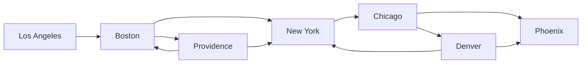
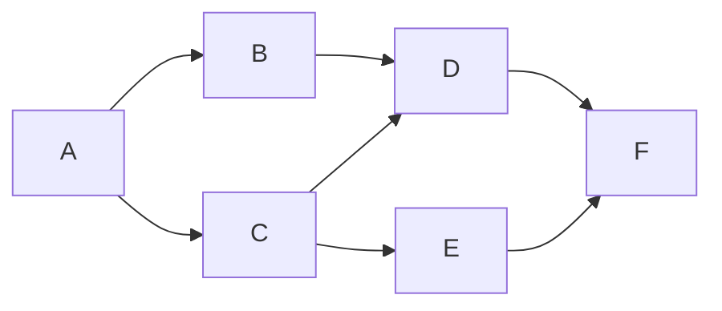

_Back to_ [[IF5100 Pemrograman untuk Data Analitik]]

# Cheatsheet IF5100 — Pemrograman untuk Data Analitik

Legenda: ⭐ = weak point (dibahas lebih dalam), ⭐⭐ = prioritas tertinggi (BFS/DFS). ⚠ = jebakan/gotcha yang sering keluar.

**Daftar isi:** 1 Review Python · 2 Rekursi · 3 Exception & Assertion · 4 ⭐ Numerik · 5 OOP · 6 ⭐ Kompleksitas · 7 ⭐ Optimasi · 8 ⭐⭐ Graf, DFS, BFS · 9 Checklist jebakan lintas topik

---

# 1. Review Python

## 1.1 Komputasi, bahasa, error
| Konsep | Inti |
|---|---|
| Komputer | hanya **menghitung** + **mengingat hasil** |
| Declarative vs imperative | fakta ("y*y = x") vs resep how-to (cara hitung akar) |
| Algoritma | sekuens langkah + flow of control + kriteria berhenti |
| Syntax error | string tak well-formed (`"hi"5`) — mudah dideteksi |
| Static semantic error | valid sintaks tapi tak bermakna (`3 + "hi"`) |
| Semantic "tersembunyi" | tidak error tapi crash / loop selamanya / jawaban salah — **paling berbahaya** |

## 1.2 Tipe, ekspresi, binding
- Scalar: `int`, `float`, `bool`, `NoneType`. `type(x)` cek tipe. Semua adalah **objek**.
- Cast: `int(3.9)` → `3` (**dipotong**, bukan dibulatkan); `int("3")` → 3; `int("hello")` → ValueError; `float(3)` → 3.0.
- `/` **selalu float**; `//` floor division; `%` modulo; `**` pangkat. int op int → int (kecuali `/`); ada float → float.
- Python **strong** (`3 + "hi"` error) tapi **dynamic** (tipe diperiksa saat runtime).
- `=` mengikat **nama → objek**. ⚠ Nilai turunan tidak otomatis dihitung ulang:
  ```python
  radius = 2.2; area = pi*radius**2; radius = radius + 1   # area TIDAK berubah
  ```
- String: `+` konkatenasi, `*` repetisi. `input()` **selalu string** → `5 * "2"` = `"22222"`.
- `0.1 + 0.2 != 0.3` (float IEEE 754) → bandingkan dengan toleransi `abs(a-b) < eps`.

## 1.3 Kontrol alur
- Perbandingan → bool. String dibandingkan leksikografis (huruf besar < huruf kecil).
- `and`/`or` **short-circuit** & mengembalikan **operan**: `"" or "default"` → `"default"`, `3 and 5` → `5`. Falsy: `0, "", [], None`.
- **Indentasi = sintaks.**
- `for i in range(start, stop, step)`: default start=0, step=1, **stop eksklusif**.
- `while`: programmer wajib menjamin kondisi akhirnya False. `break` **hanya keluar loop terdalam**.
- `for` bila iterasi diketahui di muka; `while` bila kondisi baru diketahui saat runtime.

## 1.4 Fungsi, scope
- Fungsi: nama, parameter, docstring (PEP 257), body, return. Tanpa `return` → **`None`**. `return` langsung keluar fungsi.
- Panggilan fungsi → **frame baru** (pemetaan nama→objek). Formal param di-bind ke actual param.
- Dari dalam fungsi: **boleh baca** variabel luar, **tidak boleh modifikasi** (assignment = nama lokal baru) kecuali `global` (dihindari).
  ```python
  def h(y): x += 1      # UnboundLocalError (x dianggap lokal karena di-assign)
  ```
- Fungsi adalah objek → bisa jadi argumen (`func_c(func_a)`), `lambda` = fungsi anonim.
- ⚠ Default argument mutable (`def f(a, acc=[])`) dievaluasi **sekali** → pakai `acc=None`.

## 1.5 Modul & file
- Modul = file `.py`. `import m` → `m.pi`; `from m import *` → **tanpa** nama `m` (m.pi → NameError); `import m as c`.
- `pi` lokal ≠ `circle.pi` (namespace berbeda).
- Mode: `'w'` tulis (menimpa), `'r'` baca, `'a'` append. `read()` (string utuh), `readline()`, `readlines()` (list), `write(str)`, `writelines(seq)`, `close()`.
- ⚠ `write()` hanya menerima **string** (`str(5)`). ⚠ `print(line)` dobel newline (`line` sudah berakhir `\n`) → `print(line, end='')` / `.strip()`.
- `with open(fn) as f:` → file **pasti tertutup** (pengganti try/finally).
- `calendar.monthcalendar(y, m)` → list minggu, hari di luar bulan = `0`. Thanksgiving = Kamis ke-4 Nov:
  ```python
  month = cal.monthcalendar(year, 11)
  d = month[3][cal.THURSDAY] if month[0][cal.THURSDAY] != 0 else month[4][cal.THURSDAY]
  ```
- Konvensi import: satu modul per baris, di awal, urut standar → pihak ketiga → aplikasi.

## 1.6 Structured types

| | immutable? | ordered | literal |
|---|---|---|---|
| `str` | ✔ | ✔ | `"abc"` |
| `tuple` | ✔ | ✔ | `(1,2)`, singleton `(5,)` |
| `list` | ✘ mutable | ✔ | `[1,2]` |
| `dict` | ✘ mutable | tak dijamin (konsep) | `{k:v}` |

- Index mulai 0, terakhir `-1`. `s[3]` di luar batas → IndexError.
- Slicing `[start:stop:step]`: `s[::-1]` balik, `s[3:6:2]`, `s[4:1:-2]`, `s[::]` salinan.
- `s[0] = 'y'` → TypeError (string immutable). `t[1] = 4` → TypeError (tuple).
- Swap: `(x, y) = (y, x)`. ⚠ naif `x = y; y = x` → dua-duanya sama.

**Operasi list**
| Operasi | Efek |
|---|---|
| `L.append(x)` | mutasi, tambah 1 elemen |
| `L.extend(L2)` | mutasi, tambah elemen L2 |
| `L1 + L2` | list **baru** |
| `L.sort()` | mutasi, return `None` |
| `sorted(L)` | list **baru** |
| `L.reverse()` | mutasi |
| `del L[i]` | hapus index i |
| `L.pop()` | hapus & **return** elemen terakhir |
| `L.remove(x)` | hapus kemunculan **pertama**; ValueError bila tak ada |

- `list("abc")`, `"a b".split()`, `"_".join(L)`.
- **Aliasing**: `b = a` → satu objek, mutasi terlihat di keduanya. **Clone**: `b = a[:]` (shallow; nested list tetap dibagi → `copy.deepcopy`).
- ⚠ **Jangan mutasi list saat diiterasi** (`remove_dups` melewatkan elemen) → iterasi `L1[:]`.
- Dict: key harus **unik & hashable** (int, float, str, tuple, bool). `d[k]` tak ada → KeyError; `k in d`; `del d[k]`; `d.keys()`, `d.values()`.
- Frekuensi kata:
  ```python
  for w in words:
      d[w] = d.get(w, 0) + 1
  ```
- ⚠ `words_often` **memutasi** dict masukan; `max()` pada dict kosong → ValueError.

---

# 2. Rekursi

- Rekursi = fungsi memanggil dirinya; **base case** (≥1, langsung selesai) + **recursive step** (input mengecil menuju base case). Tanpa base case terjangkau → `RecursionError` (batas default ±1000).
- Resep: (1) input mana jawabannya sudah diketahui → base case; (2) reduksi masalah → recursive step.
- Tiap pemanggilan = scope/frame sendiri; kendali kembali ke pemanggil saat `return` (stack: frame menumpuk lalu *unwind*).

```python
def mult(a, b):                 # a*b = a + a*(b-1)
    if b == 1: return a
    return a + mult(a, b-1)     # ⚠ mult(a,0) tak berujung
def fact(n):
    if n == 1: return 1         # ⚠ fact(0) tak berujung
    return n * fact(n-1)
def is_palindrome(s):           # preprocess: "".join(c.lower() for c in s if c.isalpha())
    if len(s) <= 1: return True
    return s[0] == s[-1] and is_palindrome(s[1:-1])
```

**Fibonacci**
- Rekurens: `fib(n) = fib(n-1) + fib(n-2)`. ⚠ dua konvensi: `fib(0)=0, fib(1)=1` (0,1,1,2,3,5…) vs kelinci `females(0)=females(1)=1` (1,1,2,3,5…); `females(n) = fib(n+1)`.
- Naif: `fib(5)` = **15 panggilan** (fib(3) 2×, fib(2) 3×, fib(1) 5×, fib(0) 3×) → eksponensial.
- **Memoization** → linear:
  ```python
  def fib_memo(n, cache=None):
      if cache is None: cache = {}       # ⚠ bukan cache={} (mutable default)
      if n in cache: return cache[n]
      if n <= 0: return 0
      if n == 1: return 1
      cache[n] = fib_memo(n-1, cache) + fib_memo(n-2, cache)
      return cache[n]
  # fib_memo(100) = 354224848179261915075
  ```

**Menara Hanoi**: `move(n, asal, tujuan, bantu)`: pindah `n-1` asal→bantu; pindah 1 cakram asal→tujuan; pindah `n-1` bantu→tujuan. Base: `n == 1`. Jumlah langkah **2ⁿ − 1**.

**Induksi** (untuk meyakinkan kebenaran): base benar; jika benar untuk ukuran lebih kecil maka langkah gabung benar untuk ukuran penuh. Bukti terminasi: argumen mengecil menuju base.

**Iterasi vs rekursi**: rekursi lebih ringkas/intuitif bagi programmer, lebih mahal bagi mesin (frame di call stack, bisa hitung ulang subproblem).

---

# 3. Exception & Assertion

| Exception | Penyebab |
|---|---|
| `SyntaxError` | tak bisa di-parse |
| `NameError` | nama tak ada |
| `TypeError` | tipe operan salah (`'a'/4`, `int([1])`) |
| `ValueError` | tipe benar, nilai ilegal (`int("abc")`) |
| `IndexError` | index di luar batas |
| `KeyError` | key dict tak ada |
| `AttributeError` | atribut tak ada |
| `ZeroDivisionError` | bagi nol |
| `IOError` | masalah IO (file tak ada) |

```python
try:
    ...                       # body
except ValueError: ...        # spesifik dulu
except ZeroDivisionError: ... 
except Exception as e: ...    # bare except paling akhir
else:    ...                  # jalan HANYA bila try tanpa exception
finally: ...                  # SELALU jalan (bahkan return/break/error)
```
- Urutan eksekusi: try → (exception? → except cocok) / (tidak → else) → finally.
- Penanganan error: **fail silently** (buruk) · **return nilai error** (memperumit pemanggil) · **`raise Exception("...")`** (dianjurkan).
- Studi kasus `avg(grades)` list kosong → `ZeroDivisionError`. Tiga opsi: (1) warning + return `None`; (2) ubah kebijakan `return 0.0`; (3) `raise e` → **pemanggil wajib menangani** (kalau tidak: unhandled).
- `get_ratios`: ZeroDivisionError → `nan` (dianggap sah); error lain → `raise ValueError(...)`.
- **assert**: `assert kondisi, "pesan"` → `AssertionError` bila gagal; menghentikan eksekusi. Untuk cek tipe, invarian, batas return, constraint. Pelengkap testing; **bukan** pengganti exception handling.
- ⚠ Validasi data pengguna → `if ...: raise ValueError` (bukan `assert`; `python -O` menghapus assert).

---

# 4. ⭐ Simple Numerical Programs

## 4.1 Peta metode
| Metode | Ide | Iterasi (x=25, ε=0.01) | Kompleksitas |
|---|---|---|---|
| **Exhaustive enumeration** | coba semua kandidat berurutan | **49.990** (step = ε² = 0.0001) | linear ≈ (high−low)/step |
| **Bisection** | bagi dua interval tiap iterasi | **13** | **O(log((high−low)/ε))** |
| **Newton-Raphson** | ikuti garis singgung | **4** | konvergensi kuadratik |

## 4.2 Exhaustive enumeration
- Integer (cube root perfect cube): increment `+1`, `while ans**3 < abs(x)`; cek `ans**3 != abs(x)` → bukan perfect cube; negatif → `ans = -ans`.
- Real (akar kuadrat): tak ada increment alami → `step` kecil (`ε²`) + toleransi `abs(ans**2 - x) >= epsilon`; **sangat lambat** untuk x besar.
  ```python
  step = epsilon**2; ans = 0.0
  while abs(ans**2 - x) >= epsilon and ans <= x:
      ans += step
  ```
- Kuat: mudah ditulis & dipahami. Lemah: lambat untuk ruang besar/kontinu.
- `is_prime`: cek pembagi `2..x-1` → O(x); optimasi sampai √x (`while d*d <= x`) → O(√x).

## 4.3 Bisection (pola umum untuk fungsi monoton)
```python
def sqrt_bs(x, epsilon=0.01):
    low, high = 0.0, max(1.0, x)         # ⚠ max(1,x): untuk 0<x<1 akar > x
    ans = (high + low) / 2.0
    while abs(ans**2 - x) >= epsilon:
        if ans**2 < x: low = ans         # tebakan terlalu kecil → separuh atas
        else:          high = ans        # terlalu besar → separuh bawah
        ans = (high + low) / 2.0
    return ans
```
Contoh trace `x=25, ε=0.01`:

| iter | low | high | ans | ans² | aksi |
|---|---|---|---|---|---|
| 0 | 0 | 25 | 12.5 | 156.25 | high=ans |
| 1 | 0 | 12.5 | 6.25 | 39.06 | high=ans |
| 2 | 0 | 6.25 | 3.125 | 9.77 | low=ans |
| 3 | 3.125 | 6.25 | 4.6875 | 21.97 | low=ans |
| 4 | 4.6875 | 6.25 | 5.46875 | 29.91 | high=ans |
| … | | | | | berhenti di iter 13, ans ≈ 5.0003 |

- Interval terbelah dua tiap iterasi → langkah ∝ log₂(lebar/ε).
- Kasus `0 < x < 1` (mis. x=0.25) tetap benar karena `high = max(1.0, x)`.

## 4.4 Newton-Raphson
- Rumus umum untuk akar polinomial: **x_{r+1} = x_r − f(x_r)/f'(x_r)**.
- Akar kuadrat: `f(g) = g² − x`, `f'(g) = 2g` → `g = g − (g² − x)/(2g)`; tebakan awal `g = x/2` (⚠ bukan 0 → pembagi `2g`).
  ```python
  guess = x/2
  while abs(guess**2 - x) >= epsilon:
      guess = guess - (guess**2 - x)/(2*guess)
  ```
- Trace `x=25`: 12.5 → 7.25 → 5.349 → 5.011 → **5.000013** (4 iterasi).
- Konvergensi **kuadratik** (digit benar ≈ berlipat dua tiap iterasi); kasus x=24: bisection 9/16/26 iterasi vs Newton 4/4/5 untuk ε = 0.01/1e-4/1e-6.
- Dasar algoritma **backpropagation** (gradien, dimensi tinggi). Akar cube: `f = g³ − x`, `f' = 3g²`.
- Bisa gagal: tebakan awal buruk / `f'(x)=0`. Bisection selalu konvergen bila interval awal valid, tapi lebih lambat.

## 4.5 Versi rekursif + helper
```python
def sqrt_bs_helper(x, epsilon=0.01):
    def rec(low, high):                   # nested → akses x, epsilon via closure
        ans = (high + low) / 2.0
        if abs(ans**2 - x) < epsilon: return ans     # base case
        if ans**2 < x: return rec(ans, high)         # recursive step
        else:          return rec(low, ans)
    return rec(0.0, max(1.0, x))
```
- Helper luar (non-rekursif) menyiapkan state awal (`low`, `high`) agar pemanggil cukup `f(x)`; fungsi dalam yang rekursif.
- Rekursif butuh stack frame → memori lebih besar dari `while`. Slide menamai bagian ini "Recurrence?" (maksudnya recursion).

## 4.6 ⭐ Contoh algoritma umum (numerik)

**GCD (Euclid)** — O(log min(a,b)):
```python
def gcd(a, b):
    while b:
        a, b = b, a % b
    return a            # gcd(48, 18) = 6, gcd(17, 5) = 1
```

**Faktorisasi prima (trial division sampai √n)** — exhaustive enumeration yang dioptimasi:
```python
def prime_factors(n):
    f, d = [], 2
    while d * d <= n:           # cukup sampai √n
        while n % d == 0:       # bagi habis berulang
            f.append(d); n //= d
        d += 1
    if n > 1: f.append(n)       # sisa > 1 pasti prima
    return f                    # 360 → [2,2,2,3,3,5], 97 → [97], 1001 → [7,11,13]
```

**Binary search pada list terurut** (bisection pada indeks) — O(log n):
```python
def binary_search(L, e):
    lo, hi = 0, len(L) - 1
    while lo <= hi:
        mid = (lo + hi) // 2
        if L[mid] == e:   return mid
        elif L[mid] < e:  lo = mid + 1      # buang separuh kiri
        else:             hi = mid - 1      # buang separuh kanan
    return -1                               # 1000 elemen → paling banyak ±10 langkah
```

**Akar pangkat tiga dengan bisection** (⚠ negatif & |x|<1 → batas `min(-1, x)`, `max(1, x)`):
```python
def cbrt_bs(x, eps=0.01):
    lo, hi = min(-1.0, x), max(1.0, x)
    ans = (lo + hi) / 2
    while abs(ans**3 - x) >= eps:
        if ans**3 < x: lo = ans
        else:          hi = ans
        ans = (lo + hi) / 2
    return ans              # 27 → 3.0, -8 → -1.999, 0.125 → 0.5
```

**Akar pangkat tiga dengan Newton-Raphson** (`f = g³ − x`, `f' = 3g²`):
```python
def cbrt_nr(x, eps=0.01):
    g = x / 3
    while abs(g**3 - x) >= eps:
        g = g - (g**3 - x) / (3 * g**2)
    return g                # 27 → 6 iterasi, 10 → 4 iterasi (≈ 2.154)
```

**Logaritma basis 2 tanpa `math`** — selesaikan `2**y = x` dengan bisection (fungsi naik monoton):
```python
def log2_bs(x, eps=1e-6):               # x > 1
    lo, hi = 0.0, x
    y = (lo + hi) / 2
    while abs(2**y - x) >= eps:
        if 2**y < x: lo = y
        else:        hi = y
        y = (lo + hi) / 2
    return y                # log2(8) = 3.0, log2(10) ≈ 3.3219
```

**Akar fungsi monoton sembarang (template bisection umum)**:
```python
def root_bs(f, lo, hi, eps=1e-6):       # syarat: f(lo) dan f(hi) beda tanda
    mid = (lo + hi) / 2
    while abs(f(mid)) >= eps:
        if f(lo) * f(mid) < 0: hi = mid      # akar di separuh kiri
        else:                  lo = mid      # akar di separuh kanan
        mid = (lo + hi) / 2
    return mid              # f = x³ − 2x − 5 pada [2,3] → ≈ 2.0946
```
- Pola bisection: **(1)** tentukan interval `[lo, hi]` yang memuat jawaban, **(2)** ambil titik tengah, **(3)** buang separuh yang tak mungkin, **(4)** berhenti bila `abs(f(mid)) < eps`.

---

# 5. OOP

## 5.1 Dasar
- Semua objek punya **type**, representasi data internal, dan prosedur interaksi. Objek = **instance** dari class. Dihancurkan lewat `del` / garbage collection.
- **Data attribute** ("apa objek itu") vs **method/procedural attribute** ("apa yang bisa dilakukan").
- Keuntungan OOP: bundling, divide-and-conquer, reusability, inheritance.

```python
class Coordinate(object):                 # object = superclass
    def __init__(self, x, y):             # dipanggil otomatis saat Coordinate(3,4)
        self.x = x; self.y = y            # instance variable
    def distance(self, other):
        return ((self.x-other.x)**2 + (self.y-other.y)**2) ** 0.5
    def __str__(self):                    # HARUS return string
        return "<"+str(self.x)+","+str(self.y)+">"
c = Coordinate(3,4); zero = Coordinate(0,0)
c.distance(zero) == Coordinate.distance(c, zero)    # setara
```
- `self` diisi otomatis, tak pernah diberi eksplisit. Tanpa `__str__`: `<__main__.Coordinate object at 0x...>`.
- `type(c)` → class `Coordinate`; `isinstance(c, Coordinate)` → True; `type(Coordinate)` → `<class 'type'>` (Py3; slide pakai gaya Py2).

## 5.2 Dunder method
| Method | Dipicu oleh |
|---|---|
| `__init__(self,…)` | `Class(...)` |
| `__str__(self)` | `print(obj)` |
| `__add__(self, other)` | `a + b` |
| `__sub__` | `a - b` |
| `__eq__` | `a == b` |
| `__lt__` | `a < b` |
| `__len__` | `len(a)` |

## 5.3 Getter/setter & information hiding
- Di luar class pakai `a.get_age()` / `a.set_age()`, **bukan** `a.age`. Bila implementasi berubah (`age` → `years`), kode yang pakai getter tetap jalan.
- ⚠ Python **lemah** hiding: tetap bisa baca, tulis, bahkan **buat atribut baru** dari luar (`a.size = "tiny"`) — diizinkan tapi bukan gaya yang baik.
- Default argument: `def set_name(self, newname="")` → dipakai bila argumen tak diberi.

## 5.4 Inheritance
- Hierarki: `Animal → Mammal → {Cat, Person → Student, Rabbit}`.
- Subclass mewarisi semua data & behavior; bisa **tambah attribute**, **tambah method**, **override**.
- **Method resolution**: cari di class instance dulu, lalu naik ke parent, grandparent… pakai **kecocokan pertama**.
- ⚠ Bila subclass mendefinisikan `__init__` sendiri, `__init__` parent **tidak otomatis** terpanggil → `Mammal.__init__(self, age)` / `super().__init__(age)`.
- Method baru subclass **tidak ada di superclass**: `Mammal(5).speak()` → AttributeError.
- `Cat` tak punya `__init__` → pakai milik `Mammal`/`Animal`.

## 5.5 Class variable & operator overloading (Rabbit)
```python
class Rabbit(Mammal):
    tag = 1                                # class variable: dibagi SEMUA instance
    def __init__(self, age, parent1=None, parent2=None):
        Mammal.__init__(self, age)
        self.parent1, self.parent2 = parent1, parent2
        self.rid = Rabbit.tag; Rabbit.tag += 1       # id unik otomatis
    def get_rid(self): return str(self.rid).zfill(3) # 3 → '003' (tak memotong)
    def __add__(self, other): return Rabbit(0, self, other)   # r1 + r2 = anak baru umur 0
    def __eq__(self, other):               # saudara = parent sama (dua urutan)
        same = self.parent1.rid == other.parent1.rid and self.parent2.rid == other.parent2.rid
        opp  = self.parent2.rid == other.parent1.rid and self.parent1.rid == other.parent2.rid
        return same or opp
```
- ⚠ Jangan `self.parent1 == other.parent1` di `__eq__` → rekursi `__eq__` sampai `None.parent1` → AttributeError. Bandingkan `.rid` (int).
- Class variable diubah lewat `Rabbit.tag` (class), instance variable lewat `self.`.
- Fungsi dan class sama-sama mekanisme **dekomposisi & abstraksi** (fungsi: perilaku; class: data + perilaku).

---

# 6. ⭐ Kompleksitas Algoritma

## 6.1 Cara menilai efisiensi
| Metode | Masalah |
|---|---|
| Timer (`time`) | tergantung implementasi, mesin, input; tak bisa diprediksi |
| Hitung operasi | bergantung implementasi; operasi mana yang dihitung? |
| **Order of growth (Big O)** | menilai **algoritma**, skalabilitas terhadap ukuran input ✔ |

- Operasi konstan: aritmetika, perbandingan, assignment, akses objek.
- **Best / average / worst case** — fokus **worst case** (batas atas asimtotik, **seketat mungkin**).
- Contoh: `search_for_elmt(L, e)`: best O(1) (elemen pertama), worst O(n) (tak ada).
- `time.clock()` sudah dihapus (Py 3.8) → `time.perf_counter()`.

## 6.2 Aturan penyederhanaan
1. Buang **konstanta aditif**.
2. Buang **faktor pengali konstan**.
3. Ambil **dominant term**.

| Ekspresi | Big O |
|---|---|
| `1 + 5n + 1` (`fact_iter`) | O(n) |
| `n² + 2n + 2` | O(n²) |
| `n² + 100000n + 3^1000` | O(n²) |
| `log n + n + 4` | O(n) |
| `0.0001·n·log n + 300n` | O(n log n) |
| `2n³⁰ + 3ⁿ` | O(3ⁿ) |

- **Law of Addition** (berurutan): O(f) + O(g) = O(f + g) → ambil dominan. `for n` lalu `for n*n` → O(n²).
- **Law of Multiplication** (bersarang): O(f) · O(g) = O(f · g). Loop dalam loop → O(n²).

## 6.3 Kelas kompleksitas (lambat → cepat tumbuh)

| Kelas | Nama | Ciri / contoh | n=10 | n=1000 | n=10⁶ |
|---|---|---|---|---|---|
| O(1) | konstan | akses list `L[i]`, tak bergantung ukuran | 1 | 1 | 1 |
| O(log n) | logaritmik | masalah dibelah tiap iterasi (bisection, `intToStr`) | ~1 | 3 | 6 |
| O(n) | linear | loop sederhana, linear search, rekursi sederhana | 10 | 1000 | 10⁶ |
| O(n log n) | log-linear | **merge sort**, `sorted` | 10 | 3000 | 6·10⁶ |
| O(nᶜ) | polinomial | loop bersarang (`isSubset` O(n²)) | 100 | 10⁶ | 10¹² |
| O(cⁿ) | eksponensial | ≥2 panggilan rekursif per level (Hanoi, fib naif, knapsack brute force) | 1024 | astronomis | — |

## 6.4 Pola kode → kelas
```python
for i in range(n): ...                    # O(n)
for i in range(n):
    for j in range(n): ...                # O(n²)
for i in range(n): ...
for j in range(n*n): ...                  # O(n + n²) = O(n²)
while i > 0: i = i // 10                  # O(log i)  (intToStr)
while hi - lo > eps: ... /2               # O(log)    (bisection)
```
- **Linear search**: list terurut maupun tak terurut sama-sama **O(n)** (worst case tetap lihat semua). Early `return` tidak mengubah worst case.
- `isSubset(L1, L2)` (loop dalam loop): O(len(L1)·len(L2)) → O(n²). Dengan `set(L2)`: O(n).

## 6.5 Fungsi rekursif — hitung jumlah panggilan
| Pola | Kelas |
|---|---|
| `f(n-1)` sekali | **O(n)** |
| `f(n/2)` sekali | **O(log n)** |
| `f(n-1)` dua kali | **O(2ⁿ)** (jumlah panggilan berlipat tiap level) |
| `f(n/2)` dua kali + O(n) kerja | O(n log n) (merge sort) |

| Fibonacci | Kompleksitas | Catatan |
|---|---|---|
| `fib_iter` | **O(n)** | best O(1) untuk n=0,1 |
| `fib_recur` | **O(2ⁿ)** (tepatnya ≈ φⁿ, φ≈1.618) | `fib_recur(10)` = **177** panggilan; `fib_recur(20)` = **21.891** |
| memoization | O(n) | tiap subproblem sekali |

## 6.6 Biaya operasi Python
| Struktur | O(1) | O(n) |
|---|---|---|
| **list** | `L[i]`, `L[i]=x`, `len`, `append` | `==`, `remove`, `copy`, `reverse`, iterasi, `x in L`, `insert(0,x)`, `pop(0)` |
| **dict** | rata-rata: index, store, delete, len (**hashing**) | worst case semua operasi (banyak collision) |
| **set** | rata-rata `x in s` | — |

- `L + M` membuat list baru O(len L + len M); slicing `L[i:j]` O(j−i).
- Antrean efisien: `collections.deque` (`popleft()` O(1)).

## 6.7 ⭐ Contoh algoritma umum per kelas kompleksitas

| Kelas | Algoritma contoh | Kode inti |
|---|---|---|
| **O(1)** | akses list/dict, `len`, `append` | `L[i]`, `d[k]` |
| **O(log n)** | binary search, `intToStr`, bisection, pangkat cepat | di bawah |
| **O(n)** | sum/max/min, linear search, `fib_iter`, cek duplikat dengan `set` | `for x in L` |
| **O(n log n)** | merge sort, `sorted()` | di bawah |
| **O(n²)** | selection/bubble/insertion sort, cek duplikat `i,j`, `isSubset` | loop bersarang |
| **O(2ⁿ)** | power set, `fib` naif, Hanoi, brute force knapsack | di bawah |

**O(log n) — pangkat cepat (exponentiation by squaring)**
```python
def pow_fast(b, e):
    if e == 0: return 1
    h = pow_fast(b, e // 2)             # masalah dibelah dua
    return h * h if e % 2 == 0 else h * h * b      # pow_fast(3, 13) = 1594323
```

**O(n log n) — merge sort**: belah dua (log n level) lalu gabung (O(n) per level)
```python
def merge_sort(L):
    if len(L) < 2: return L[:]
    m = len(L) // 2
    a, b = merge_sort(L[:m]), merge_sort(L[m:])
    i = j = 0; out = []
    while i < len(a) and j < len(b):
        if a[i] <= b[j]: out.append(a[i]); i += 1
        else:            out.append(b[j]); j += 1
    return out + a[i:] + b[j:]          # [5,2,9,1,5,6,0] → [0,1,2,5,5,6,9]
```

**O(n²) — selection sort** (loop luar n × cari min O(n))
```python
def selection_sort(L):
    L = L[:]
    for i in range(len(L)):
        m = min(range(i, len(L)), key=lambda k: L[k])
        L[i], L[m] = L[m], L[i]
    return L
```

**Duplikat: O(n²) vs O(n)** (tukar waktu dengan ruang)
```python
def has_dup_n2(L):                       # O(n²)
    for i in range(len(L)):
        for j in range(i + 1, len(L)):
            if L[i] == L[j]: return True
    return False
def has_dup_n(L):                        # O(n) rata-rata (hashing)
    return len(set(L)) != len(L)
```

**O(2ⁿ) — power set** (tiap elemen: ikut / tidak ikut)
```python
def powerset(L):
    if not L: return [[]]
    rest = powerset(L[1:])
    return rest + [[L[0]] + s for s in rest]    # n=4 → 16 himpunan bagian
```
**Hanoi**: `T(n) = 2·T(n−1) + 1` → `2ⁿ − 1` (n=3: 7, n=10: 1023).

**Rumus cepat rekurens**
| Rekurens | Hasil |
|---|---|
| `T(n) = T(n−1) + O(1)` | O(n) |
| `T(n) = T(n/2) + O(1)` | O(log n) (binary search) |
| `T(n) = T(n−1) + O(n)` | O(n²) |
| `T(n) = 2T(n/2) + O(n)` | O(n log n) (merge sort) |
| `T(n) = 2T(n−1) + O(1)` | O(2ⁿ) (Hanoi, fib naif) |

---

# 7. ⭐ Masalah Optimasi (Knapsack)

## 7.1 Model
- **Optimization model** = **objective function** (max/min) + **constraint** (boleh kosong). Tiga keluarga model komputasional: optimization, statistical, simulation.
- **0/1 knapsack**: tiap barang `<value, weight>`, diambil utuh atau tidak. Vektor biner `V`:
  - maksimalkan `Σ V[i]·I[i].value`
  - dengan `Σ V[i]·I[i].weight ≤ w`
- **Continuous (fractional)** knapsack: boleh pecahan → greedy by density **optimal**. 0/1 → NP-hard, greedy **tidak** menjamin optimal.
- **Brute force**: enumerasi **power set** (2ⁿ himpunan bagian) → buang yang melanggar → pilih terbaik. 2¹⁰⁰ ≈ 1,27·10³⁰ → tak praktis.

## 7.2 Tiga strategi (ringkas)
| | Greedy | Brute force (decision tree) | Dynamic programming |
|---|---|---|---|
| Optimal? | **tidak dijamin** | ✔ | ✔ |
| Waktu | **O(n log n)** (sort) | **eksponensial** O(2ⁿ) | sering cepat: ∝ jumlah pasangan `(len(toConsider), avail)` berbeda |
| Ide | ambil "terbaik" lokal yang muat | cabang ambil/tidak ambil, rekursif | brute force + **memo** untuk subproblem tumpang tindih |

## 7.3 Greedy
```python
def greedy(items, maxCost, keyFunction):
    itemsCopy = sorted(items, key=keyFunction, reverse=True)   # O(n log n)
    result, totalValue, totalCost = [], 0.0, 0.0
    for it in itemsCopy:
        if totalCost + it.getCost() <= maxCost:
            result.append(it); totalCost += it.getCost(); totalValue += it.getValue()
    return (result, totalValue)
# kriteria:
greedy(foods, 750, Food.getValue)                  # paling bernilai
greedy(foods, 750, lambda x: 1/Food.getCost(x))    # paling murah (reverse=True → 1/cost)
greedy(foods, 750, Food.density)                   # value/cost tertinggi
```
- `lambda args: expr` = fungsi anonim (jangan yang rumit; pakai `def`).
- Menu 8 makanan (juice 89/100, coffee 90/123, pizza 95/258, burger 100/354, fries 90/365, coke 79/150, apple 50/95, donut 10/195):

| Budget | by value | by cost | by density | brute force (`maxVal`) |
|---|---|---|---|---|
| 750 | 285 | 318 | **403** | 403 |
| 1000 | **453** | 413 | 413 | **453** |

  ⚠ Density **tidak selalu menang**: optimal lokal ≠ optimal global. Pro: mudah & cepat. Con: tak optimal, tak tahu seberapa dekat.
- Contoh tandingan: `(60,10), (100,20), (120,30)`, kapasitas 50 → greedy density = 160, optimal = 220.

## 7.4 Decision tree (`maxVal`)
```python
def maxVal(toConsider, avail):
    if toConsider == [] or avail == 0:                      # (1) habis
        result = (0, ())
    elif toConsider[0].getCost() > avail:                   # (2) terlalu berat → lewati
        result = maxVal(toConsider[1:], avail)
    else:                                                   # (3) bandingkan dengan vs tanpa
        nxt = toConsider[0]
        withVal, withTake = maxVal(toConsider[1:], avail - nxt.getCost())
        withVal += nxt.getValue()
        withoutVal, withoutTake = maxVal(toConsider[1:], avail)
        if withVal > withoutVal: result = (withVal, withTake + (nxt,))
        else:                    result = (withoutVal, withoutTake)
    return result
```
- Pohon: anak **kiri = ambil**, kanan = tidak ambil; enumerasi **left-first, depth-first**. Level = n; node level i = 2ⁱ; total 2ⁿ⁺¹−1 (slide: O(n·2ⁿ)).
- Node = `<taken, left, value, remaining>`. Pruning (tak menelusuri yang melanggar constraint) **tidak mengubah** kompleksitas worst case.
- Jumlah panggilan terukur: 5 item → 61, 10 → 954, 15 → 12.536, 20 → 96.946 (eksponensial).

## 7.5 Dynamic programming & memoization (contoh: Fibonacci)
- **Memoization** = tukar **waktu dengan ruang**: simpan hasil subproblem di **dictionary** (`memo`); sebelum menghitung, cek dulu; bila belum ada hitung lalu simpan.
- Syarat DP: **optimal substructure** (solusi optimal dibangun dari solusi optimal subproblem, `fib(n) = fib(n-1) + fib(n-2)`) + **overlapping subproblems** (subproblem yang sama dihitung berulang: `fib(3)` muncul 2×, `fib(2)` 3×, ...).

**(a) Naif — eksponensial**
```python
def fib(n):
    if n < 2: return n
    return fib(n-1) + fib(n-2)          # fib(20): 21.891 panggilan, fib(6): 25 panggilan
```

**(b) Top-down + memo dictionary** (rekursif + cache) — **O(n)**
```python
def fib_memo(n, memo=None):
    if memo is None: memo = {}           # ⚠ bukan memo={} (mutable default)
    if n < 2: return n                   # base case
    if n in memo: return memo[n]         # sudah pernah dihitung → pakai
    memo[n] = fib_memo(n-1, memo) + fib_memo(n-2, memo)   # hitung lalu SIMPAN
    return memo[n]
# fib_memo(20): 39 panggilan (vs 21.891); fib_memo(100) = 354224848179261915075
```
Alur: cek memo → base case → hitung rekursif → simpan → return. Setiap `n` dihitung **sekali** → panggilan ≈ 2n−1.

**(c) Bottom-up (tabel/iteratif)** — O(n) waktu, O(1) ruang
```python
def fib_bu(n):
    if n < 2: return n
    a, b = 0, 1                          # fib(0), fib(1)
    for _ in range(n - 1):
        a, b = b, a + b
    return b
```
Versi tabel dictionary/list: `table = {0: 0, 1: 1}; for i in range(2, n+1): table[i] = table[i-1] + table[i-2]`.

| | Naif | Memo (top-down) | Bottom-up |
|---|---|---|---|
| Waktu | O(2ⁿ) (≈ φⁿ) | O(n) | O(n) |
| Ruang | O(n) (stack) | O(n) (dict + stack) | O(1) (dua variabel) |
| `fib(20)` panggilan | 21.891 | 39 | — (loop 19×) |

**Contoh DP kedua yang sama polanya — tangga**: cara naik `n` anak tangga dengan langkah 1 atau 2 = `ways(n) = ways(n-1) + ways(n-2)` (⇒ Fibonacci; `ways(5)=8`, `ways(10)=89`).

**Faktorial: memo tidak membantu dalam satu panggilan** — `fact(n) = n * fact(n-1)` memanggil tiap subproblem **sekali** (tidak ada *overlapping subproblems*), jadi memo hanya menolong bila **dipanggil berulang dengan memo yang sama** (mis. `m = {}; fact(10, m); fact(12, m)` → panggilan kedua hanya 3 langkah baru). Pelajaran: DP bermanfaat hanya bila subproblem **tumpang tindih**.
```python
def fact(n, memo=None):
    if memo is None: memo = {}
    if n <= 1: return 1
    if n not in memo: memo[n] = n * fact(n-1, memo)
    return memo[n]
```

**Penerapan ke 0/1 knapsack** (soal kuliah): subproblem ditentukan hanya `(len(toConsider), avail)` → `memo[(len(toConsider), avail)]`; pola kodenya persis `fib_memo`: cek memo → base case → hitung dengan/tanpa item → **simpan** → return. Menu kecil a-d, budget 5: `maxVal` 17 panggilan vs memo 14; 16 item: 2¹⁶ = 65.536 vs ≈ 5.191 panggilan.
- ⚠ "Bukan mukjizat": worst case tetap eksponensial; cepat karena jumlah pasangan `(toConsider, avail)` berbeda terbatas (**pseudo-polinomial**, ∝ n·W).
- ⚠ `memo={}` default dipakai bersama antar pemanggilan → hasil basi → `memo=None`.
- Greedy: cepat tapi mungkin tak optimal. DP: pasti benar dan sering cepat.

## 7.6 ⭐ Contoh algoritma umum (optimasi)

**Fractional knapsack — greedy by density terbukti optimal** (barang boleh dipecah)
```python
def frac_knap(items, W):                 # items: list (value, weight)
    total = 0.0
    for v, w in sorted(items, key=lambda t: t[0]/t[1], reverse=True):
        if W >= w: total += v; W -= w                # ambil utuh
        else:      total += v * W / w; break         # ambil pecahan lalu selesai
    return total        # [(60,10),(100,20),(120,30)], W=50 → 240.0  (0/1 hanya 220)
```

**Coin change: greedy vs DP** (greedy tidak selalu benar)
```python
def coin_greedy(coins, amt):
    n = 0
    for c in sorted(coins, reverse=True):
        n += amt // c; amt %= c
    return n if amt == 0 else None

def coin_dp(coins, amt):                 # bottom-up, dp[a] = koin minimum untuk a
    INF = 10**9
    dp = [0] + [INF] * amt
    for a in range(1, amt + 1):
        for c in coins:
            if c <= a and dp[a - c] + 1 < dp[a]:
                dp[a] = dp[a - c] + 1
    return dp[amt] if dp[amt] < INF else None
# koin {1,3,4}, amt 6: greedy = 3 (4+1+1), DP = 2 (3+3)   ← greedy GAGAL
# koin {1,5,10,25}, amt 63: keduanya 6 (greedy benar untuk sistem koin ini)
```

**0/1 knapsack bottom-up (tabel 1-D)** — O(n·W)
```python
def knap_bu(items, W):                   # items: list (value, weight)
    dp = [0] * (W + 1)
    for v, w in items:
        for c in range(W, w - 1, -1):    # mundur supaya tiap barang dipakai ≤ 1×
            dp[c] = max(dp[c], dp[c - w] + v)
    return dp[W]        # [(60,10),(100,20),(120,30)], W=50 → 220
```

**Pola memilih strategi**
| Pertanyaan | Strategi |
|---|---|
| Bisa dipecah (fractional)? / pilihan lokal terbukti benar? | **Greedy** |
| Tidak greedy-safe, tapi subproblem tumpang tindih? | **DP / memoization** |
| n kecil (< ~20) dan butuh pasti optimal? | **Brute force** (decision tree) |

---

# 8. ⭐⭐ Graf, DFS, dan BFS

## 8.1 Definisi (hafal)
| Istilah | Arti |
|---|---|
| **Graph** | himpunan **node/vertex** + himpunan **edge/arc** (pasangan node) |
| **Undirected (graph)** | edge bisa dilewati dua arah |
| **Directed (digraph)** | edge punya **source (parent)** → **destination (child)** |
| **Weighted / unweighted** | edge punya bobot (waktu, jarak) atau tidak |
| **Tree** | digraph di mana tiap pasangan node terhubung **tepat satu path** |
| **Path** | urutan edge; source edge berikutnya = destination edge sebelumnya |
| **Shortest path** | path dengan **jumlah edge** minimum |
| **Shortest weighted path** | meminimalkan **jumlah bobot** |
| **Cycle** | path kembali ke node awal → alasan harus mencatat node terkunjungi |

- Inferensi pada graf: ada path A→B? shortest path; **graph partition**; **min-cut / max-flow**.
- **Königsberg (Euler 1735)**: pulau = node, jembatan = edge; abstraksi membuang detail tak relevan. Path melewati tiap edge tepat sekali ada hanya bila jumlah node berderajat ganjil = **0 atau 2** (Königsberg: derajat 5,3,3,3 → **tidak ada**).

## 8.2 Representasi
| | Adjacency matrix | Adjacency list (dipakai deck) |
|---|---|---|
| Struktur | baris = source, kolom = dest, sel 1/0 (digraph: tak simetris) | dict: node → list children |
| Memori | O(V²) | O(V + E) |
| Cek edge s→d | O(1) | O(deg s) |
| Cocok | graf padat | graf jarang |

## 8.3 Implementasi (adjacency list)
```python
class Node(object):
    def __init__(self, name): self.name = name
    def getName(self): return self.name
    def __str__(self): return self.name

class Edge(object):
    def __init__(self, src, dest): self.src = src; self.dest = dest
    def getSource(self): return self.src
    def getDestination(self): return self.dest
    def __str__(self): return self.src.getName() + '->' + self.dest.getName()

class Digraph(object):
    def __init__(self): self.edges = {}                 # node -> [children]
    def addNode(self, node):
        if node in self.edges: raise ValueError('Duplicate node')
        self.edges[node] = []
    def addEdge(self, edge):
        src, dest = edge.getSource(), edge.getDestination()
        if not (src in self.edges and dest in self.edges):
            raise ValueError('Node not in graph')
        self.edges[src].append(dest)
    def childrenOf(self, node): return self.edges[node]
    def hasNode(self, node): return node in self.edges
    def getNode(self, name):                            # pencarian linear berdasar nama
        for n in self.edges:
            if n.getName() == name: return n
        raise NameError(name)

class Graph(Digraph):                                   # tak berarah = digraph + edge terbalik
    def addEdge(self, edge):
        Digraph.addEdge(self, edge)
        Digraph.addEdge(self, Edge(edge.getDestination(), edge.getSource()))
```
- **Mengapa `Graph` subclass `Digraph`** (bukan sebaliknya): **Liskov Substitution** — kode yang jalan dengan `Digraph` jalan juga dengan `Graph` (graf tak berarah = digraph dengan tiap edge dua arah); sebaliknya tidak.
- Urutan `children` = urutan `addEdge` → menentukan urutan jelajah DFS/BFS!

## 8.4 Graf kota (contoh deck, dipakai di semua trace)
| Node | Children (urut) |
|---|---|
| Boston | Providence, New York |
| Providence | Boston, New York |
| New York | Chicago |
| Chicago | Denver, Phoenix |
| Denver | Phoenix, New York |
| Los Angeles | Boston |
| Phoenix | — (dead end) |



## 8.5 ⭐⭐ DFS (Depth-First Search) — kode deck
```python
def DFS(graph, start, end, path, shortest, toPrint=False):
    path = path + [start]                       # path BARU (bukan append in-place)
    if toPrint: print('Current DFS path:', printPath(path))
    if start == end:
        return path                             # tujuan ketemu
    for node in graph.childrenOf(start):        # urutan = urutan children
        if node not in path:                    # hindari SIKLUS (cek di path saat ini)
            if shortest == None or len(path) < len(shortest):   # PRUNING
                newPath = DFS(graph, node, end, path, shortest, toPrint)
                if newPath != None:
                    shortest = newPath          # simpan path lebih pendek
        elif toPrint:
            print('Already visited', node)
    return shortest

def shortestPath(graph, start, end, toPrint=False):    # WRAPPER
    return DFS(graph, start, end, [], None, toPrint)
```

**Ide**: jelajah **sedalam mungkin** (left-first), bila buntu / semua opsi habis → **backtrack**. Rekursif → memakai **call stack**. Divide-and-conquer: path start→tujuan = start→node antara + node antara→tujuan.

**Cara baca kode (untuk trace ujian):**
1. `path` = jalur dari start ke node sekarang (list baru tiap panggilan).
2. Cetak "Current DFS path" **setiap kali masuk** DFS.
3. Jika `start == end` → langsung `return path`.
4. Untuk tiap child (urutan adjacency): bila sudah ada di `path` → cetak "Already visited" & lewati; selain itu hanya turun bila `shortest` kosong **atau** `len(path) < len(shortest)` (pruning: panjang path **saat ini** harus < panjang shortest).
5. Setelah anak selesai, bila ada hasil → `shortest = newPath`.
6. `return shortest` (bisa `None` → "There is no path").

**Trace Boston → Phoenix** (terverifikasi dengan menjalankan kode):
```
Current DFS path: Boston
Current DFS path: Boston->Providence
Already visited Boston                              (Providence→Boston: siklus)
Current DFS path: Boston->Providence->New York
Current DFS path: Boston->Providence->New York->Chicago
Current DFS path: Boston->Providence->New York->Chicago->Denver
Current DFS path: Boston->Providence->New York->Chicago->Denver->Phoenix   ← path pertama (5 edge)
Already visited New York                            (Denver→New York: siklus)
Current DFS path: Boston->Providence->New York->Chicago->Phoenix           ← lebih pendek (4 edge)
Current DFS path: Boston->New York                  (backtrack ke Boston, child ke-2)
Current DFS path: Boston->New York->Chicago
Current DFS path: Boston->New York->Chicago->Denver
Current DFS path: Boston->New York->Chicago->Denver->Phoenix               (dicetak, tak lebih pendek)
Already visited New York
Current DFS path: Boston->New York->Chicago->Phoenix                       ← 3 edge, hasil akhir
Shortest path from Boston to Phoenix is Boston->New York->Chicago->Phoenix
```
⚠ Slide deck menulis hasil akhir `Boston->New York->Chicago->Denver->Phoenix` (4 edge), tetapi menjalankan kode memberi `Boston->New York->Chicago->Phoenix` (**3 edge**). Pegang hasil eksekusi.

**Trace Chicago → Boston** (tidak ada path):
```
Chicago → Chicago->Denver → Chicago->Denver->Phoenix → Chicago->Denver->New York
→ Already visited Chicago → Chicago->Phoenix → "There is no path from Chicago to Boston"
```
(Boston hanya punya edge masuk dari Providence & LA; dari Chicago tak terjangkau.)

**Catatan penting DFS**
- Path **pertama** yang ditemukan **bukan** otomatis terpendek; DFS harus menjelajah (dengan pruning) dan memperbarui `shortest`.
- Tanpa `node not in path` pada graf bersiklus → **rekursi tak berhingga** → `RecursionError`.
- `shortestPath` = **wrapper** agar pemanggil tak perlu tahu `path=[]`, `shortest=None` (abstraksi; pola umum rekursi).
- Cek `node not in path` hanya mencegah siklus **di path saat ini**; node yang sama bisa dikunjungi lewat path berbeda → versi deck menjelajah **path**, bukan node → worst case **eksponensial** (bukan O(V+E)).

## 8.6 ⭐⭐ BFS (Breadth-First Search) — kode deck
```python
def BFS(graph, start, end, toPrint=False):
    initPath = [start]
    pathQueue = [initPath]                      # antrean berisi PATH
    while len(pathQueue) != 0:
        tmpPath = pathQueue.pop(0)              # dequeue (FIFO)
        if toPrint: print('Current BFS path:', printPath(tmpPath))
        lastNode = tmpPath[-1]
        if lastNode == end:
            return tmpPath                      # path PERTAMA yang sampai = hop minimum
        for nextNode in graph.childrenOf(lastNode):
            if nextNode not in tmpPath:         # hindari siklus dalam path ini
                pathQueue.append(tmpPath + [nextNode])   # enqueue
    return None                                 # tak ada path
```

**Ide**: jelajah **level per level** — semua path dengan *n* hop sebelum path *n+1* hop. **Iteratif**, struktur data = **queue of paths** (FIFO), bukan call stack.

**Cara baca kode (untuk trace ujian):**
1. Queue awal: `[[start]]`.
2. Ambil path **paling depan**; cetak.
3. Bila ujungnya = tujuan → **selesai** (jaminan hop minimum).
4. Else tambahkan (di **belakang** queue) satu path baru per child yang belum ada di path itu, berurutan sesuai adjacency.
5. Queue kosong → `None`.

**Trace Boston → Phoenix** (urutan dequeue, terverifikasi):

| # | Dequeue (path) | Enqueue (anak baru) |
|---|---|---|
| 1 | Boston | Boston→Providence, Boston→New York |
| 2 | Boston→Providence | Boston→Providence→New York *(Boston ditolak: sudah di path)* |
| 3 | Boston→New York | Boston→New York→Chicago |
| 4 | Boston→Providence→New York | Boston→Providence→New York→Chicago |
| 5 | Boston→New York→Chicago | →Denver, →Phoenix |
| 6 | Boston→Providence→New York→Chicago | →Denver, →Phoenix |
| 7 | Boston→New York→Chicago→Denver | …→Denver→Phoenix *(New York ditolak)* |
| 8 | **Boston→New York→Chicago→Phoenix** | ← ujung = Phoenix → **return** (3 hop) |

Urutan cetak "Current BFS path":
```
Boston
Boston->Providence
Boston->New York
Boston->Providence->New York
Boston->New York->Chicago
Boston->Providence->New York->Chicago
Boston->New York->Chicago->Denver
Boston->New York->Chicago->Phoenix        ← stop
```
Pola: 0 hop → 1 hop (2 path) → 2 hop (2 path) → 3 hop … path 3-hop pertama yang berakhir di Phoenix adalah jawabannya.

**Catatan penting BFS**
- Path pertama yang tiba di tujuan **dijamin** jumlah edge minimum → boleh berhenti langsung (tak perlu pruning seperti DFS).
- ⚠ BFS **tidak** bisa langsung untuk **shortest weighted path**: path berbobot terkecil bisa punya **lebih banyak hop**. (Contoh: `S→T` bobot 10 [1 hop] vs `S→A→B→T` bobot 2+3+1=6 [3 hop]; BFS pilih `S→T`, DFS berbobot pilih `S→A→B→T`.)
- `pop(0)` pada list = O(n); pakai `collections.deque().popleft()` bila perlu efisien.
- Versi efisien (**set visited** global / `prev` dict) → **O(V + E)**; versi deck menyimpan path penuh di queue → lebih boros memori.
- Graf tak terarah: BFS dari Phoenix→Boston pada `Digraph` = `None` (Phoenix tanpa edge keluar), pada `Graph` (dua arah) path ada.

## 8.7 ⭐⭐ DFS vs BFS — tabel perbandingan

| Aspek | **DFS** | **BFS** |
|---|---|---|
| Strategi | sedalam mungkin, lalu **backtrack** | **level demi level** (n hop dulu) |
| Gaya kode | **rekursif** | **iteratif** |
| Struktur data | **call stack** (rekursi) | **queue of paths** (FIFO) |
| Urutan menemukan tujuan | path pertama bukan tentu terpendek | path pertama = hop minimum |
| Kapan berhenti | setelah semua opsi dijelajah (dengan pruning `len(path) < len(shortest)`) | begitu path berujung tujuan di-dequeue |
| Shortest (jumlah edge) | ✔ (setelah menjelajah, dengan pruning) | ✔ (path pertama) |
| Shortest **weighted** | ✔ mudah: bandingkan total bobot, bukan `len(path)` | ✘ tidak langsung |
| Cycle handling | `node not in path` | `nextNode not in tmpPath` |
| Kompleksitas versi deck | bisa **eksponensial** (menjelajah path) | bisa eksponensial di memori (path penuh); dengan visited set O(V+E) |
| Standar untuk berbobot | — | **Dijkstra** (priority queue) |

**Mnemonik**: DFS = **Stack**/rekursi, "masuk lubang sedalam-dalamnya"; BFS = **Queue**, "gelombang riak di air".

## 8.8 Template menjawab soal graf
1. **Gambar graf** dari adjacency list; tandai urutan children (menentukan jelajah).
2. **DFS**: tulis path saat ini tiap masuk; tandai "Already visited" untuk child yang sudah di path; ingat pruning `len(path) < len(shortest)` setelah `shortest` terisi; backtrack ke child berikutnya setelah buntu.
3. **BFS**: tulis queue; dequeue depan; cek ujung = tujuan; enqueue child tak berulang di path itu; keluar saat ujung = tujuan.
4. Sebutkan hasil + **jumlah edge** (bukan jumlah node).
5. Bila diminta bobot → DFS dimodifikasi (`sum(weights)`); jelaskan kenapa BFS gagal.
6. Bila tak ada path → DFS return `None`/cetak "no path"; BFS queue kosong → `None`.

## 8.9 Pertanyaan konsep yang sering muncul
- **Apa yang terjadi jika `node not in path` dihapus?** Siklus (Boston→Providence→Boston…) → rekursi tak hingga → `RecursionError`.
- **Mengapa `shortestPath` dibuat wrapper?** Menginisialisasi `path=[]`, `shortest=None`, dan menyembunyikan parameter internal (abstraksi).
- **Mengapa BFS menjamin hop minimum?** Path diproses berurutan menurut jumlah hop; yang pertama tiba di tujuan tak mungkin ada yang lebih pendek.
- **Mengapa adjacency list umum dipakai?** Jaringan nyata jarang (sparse): memori O(V+E) vs matrix O(V²).
- **Mengapa DFS cocok untuk weighted?** Tinggal bandingkan total bobot path; pruning pakai bobot (positif) path parsial.
- **Reachable set dari Boston** (graf kota): Boston, Chicago, Denver, New York, Phoenix, Providence (Los Angeles tak tercapai — tak ada edge masuk). Dari Denver: Chicago, Denver, New York, Phoenix. Dari Phoenix: hanya Phoenix.
- **Euler path** (undirected terhubung): ada bila derajat ganjil ∈ {0, 2}.

## 8.10 ⭐⭐ Contoh algoritma graf umum

Semua contoh memakai graf `G` berbentuk dict adjacency sederhana (lebih ringkas untuk ujian/tulis tangan):
```python
G = {'A': ['B', 'C'], 'B': ['D'], 'C': ['D', 'E'], 'D': ['F'], 'E': ['F'], 'F': []}
```


**BFS umum — urutan kunjungan (visited set)** — O(V + E)
```python
from collections import deque
def bfs_order(G, s):
    seen = {s}; q = deque([s]); out = []
    while q:
        u = q.popleft()                  # FIFO
        out.append(u)
        for v in G[u]:
            if v not in seen:            # tandai SAAT enqueue (bukan saat dequeue)
                seen.add(v); q.append(v)
    return out                           # ['A','B','C','D','E','F']
```

**BFS — jarak (jumlah edge) dari sumber ke semua node**
```python
def bfs_dist(G, s):
    d = {s: 0}; q = deque([s])
    while q:
        u = q.popleft()
        for v in G[u]:
            if v not in d:
                d[v] = d[u] + 1; q.append(v)
    return d                             # {'A':0,'B':1,'C':1,'D':2,'E':2,'F':3}
```

**DFS umum — rekursif**
```python
def dfs_rec(G, u, seen=None, out=None):
    if seen is None: seen, out = set(), []
    seen.add(u); out.append(u)
    for v in G[u]:
        if v not in seen:
            dfs_rec(G, v, seen, out)
    return out                           # ['A','B','D','F','C','E']
```

**DFS — iteratif dengan stack eksplisit** (ganti `deque.popleft` BFS menjadi `pop` ⇒ DFS)
```python
def dfs_iter(G, s):
    seen = set(); st = [s]; out = []
    while st:
        u = st.pop()                     # LIFO
        if u in seen: continue
        seen.add(u); out.append(u)
        for v in reversed(G[u]):         # reversed agar urutan sama dgn rekursif
            st.append(v)
    return out                           # ['A','B','D','F','C','E']
```
- BFS **tandai saat enqueue**; DFS iteratif **tandai saat pop**.
- Satu-satunya beda BFS ↔ DFS iteratif: **queue (FIFO) vs stack (LIFO)**.

**Reachability / komponen terhubung (undirected)** — jalankan DFS/BFS dari tiap node belum dikunjungi
```python
def components(U):
    seen = set(); comps = []
    for s in U:
        if s in seen: continue
        comp = []; st = [s]; seen.add(s)
        while st:
            u = st.pop(); comp.append(u)
            for v in U[u]:
                if v not in seen: seen.add(v); st.append(v)
        comps.append(sorted(comp))
    return comps
# {'A':['B'],'B':['A','C'],'C':['B'],'D':['E'],'E':['D'],'F':[]} → [['A','B','C'], ['D','E'], ['F']]
```

**Deteksi siklus pada digraph (DFS tiga warna)**
```python
def has_cycle(G):
    WHITE, GRAY, BLACK = 0, 1, 2
    color = {u: WHITE for u in G}
    def dfs(u):
        color[u] = GRAY                          # sedang di path saat ini
        for v in G[u]:
            if color[v] == GRAY: return True     # back edge → siklus
            if color[v] == WHITE and dfs(v): return True
        color[u] = BLACK; return False
    return any(color[u] == WHITE and dfs(u) for u in G)
# a→b→c→a: True;  G di atas: False
```

**Topological sort (Kahn, BFS berbasis in-degree)** — hanya untuk DAG
```python
def topo(G):
    indeg = {u: 0 for u in G}
    for u in G:
        for v in G[u]: indeg[v] += 1
    q = deque(u for u in G if indeg[u] == 0); out = []
    while q:
        u = q.popleft(); out.append(u)
        for v in G[u]:
            indeg[v] -= 1
            if indeg[v] == 0: q.append(v)
    return out          # {'A':['B','C'],'B':['D'],'C':['D'],'D':[]} → ['A','B','C','D']
```

**Labirin (grid) dengan BFS — langkah minimum** (motivasi "maze solver" slide 1b)
```python
def maze_bfs(maze):                      # 'S' start, 'E' end, '#' dinding
    R, C = len(maze), len(maze[0])
    for r in range(R):
        for c in range(C):
            if maze[r][c] == 'S': s = (r, c)
            if maze[r][c] == 'E': e = (r, c)
    q = deque([s]); prev = {s: None}
    while q:
        u = q.popleft()
        if u == e:                       # rekonstruksi jarak via prev
            n = 0
            while prev[u] is not None: u = prev[u]; n += 1
            return n
        r, c = u
        for dr, dc in ((1,0), (-1,0), (0,1), (0,-1)):
            nr, nc = r + dr, c + dc
            if 0 <= nr < R and 0 <= nc < C and maze[nr][nc] != '#' and (nr, nc) not in prev:
                prev[(nr, nc)] = u; q.append((nr, nc))
    return None                          # tak ada jalan
```
- Node = sel `(r, c)`, edge = 4 tetangga (atas/bawah/kiri/kanan) yang bukan dinding. BFS ⇒ langkah minimum.

**Shortest path berbobot — Dijkstra** (bobot non-negatif, priority queue)
```python
import heapq
def dijkstra(W, s):                      # W: {u: [(v, bobot), ...]}
    dist = {s: 0}; pq = [(0, s)]
    while pq:
        d, u = heapq.heappop(pq)         # node dengan jarak terkecil
        if d > dist.get(u, float('inf')): continue
        for v, w in W[u]:
            nd = d + w
            if nd < dist.get(v, float('inf')):
                dist[v] = nd; heapq.heappush(pq, (nd, v))
    return dist
# {'S':[('A',2),('T',10)],'A':[('B',3)],'B':[('T',1)],'T':[]} → {'S':0,'A':2,'B':5,'T':6}
```
- Dijkstra ≈ "BFS dengan priority queue": queue FIFO diganti heap menurut jarak kumulatif.

**Ringkasan memilih algoritma graf**
| Tujuan | Algoritma |
|---|---|
| Shortest path **jumlah edge** | **BFS** |
| Shortest path **berbobot** (≥0) | Dijkstra (atau DFS dimodifikasi pada graf kecil) |
| Ada path? / reachability / komponen | DFS atau BFS |
| Deteksi siklus (digraph) | DFS tiga warna |
| Urutan dependensi (DAG) | Topological sort |
| Labirin / grid terpendek | BFS pada grid |

---

# 9. Checklist jebakan lintas topik

| Topik | Jebakan |
|---|---|
| Tipe | `int(3.9)` = 3 (potong); `input()` = string; `/` selalu float |
| Float | `0.1+0.2 != 0.3` → pakai toleransi |
| Scope | assignment di fungsi = lokal baru; `x += 1` pada global → `UnboundLocalError` |
| Default arg | mutable default dibagi antar panggilan (`acc=[]`, `memo={}`, `cache={}`) |
| List | alias vs clone; `sort()` return None; jangan mutasi saat iterasi; clone dangkal |
| Tuple | singleton `(5,)`; immutable |
| Dict | key harus hashable & unik; `KeyError`; tak ada urutan (konsep) |
| File | `print(line)` dobel newline; `write` butuh str; pakai `with` |
| Rekursi | base case harus terjangkau (`mult(a,0)`, `fact(0)`); fib 0/1 vs 1/1; naif eksponensial |
| Exception | urutan `except` spesifik → umum; `finally` selalu jalan; `else` hanya tanpa exception |
| assert | bukan validasi input pengguna (hilang dengan `-O`) |
| Bisection | `high = max(1.0, x)`; interval terbelah dua; kondisi pakai `abs(ans**2 - x) >= eps` |
| Newton | tebakan awal ≠ 0; konvergensi kuadratik; bisa divergen |
| OOP | `self` implisit; `__init__` parent tak otomatis; `__str__` harus return str; class var vs instance var; `__eq__` jangan bandingkan objek langsung |
| Big O | buang konstanta; ambil dominan; sequential = tambah, nested = kali; linear search tetap O(n) walau terurut |
| dict/list cost | `x in list` O(n) vs `x in set/dict` O(1) rata-rata; `pop(0)` O(n) |
| Knapsack | greedy density tak selalu optimal (budget 1000: 413 < 453); `memo={}` stale |
| DP | syarat: optimal substructure + overlapping subproblems; memo = dictionary, `memo=None`; faktorial tak punya overlap; key knapsack `(len(toConsider), avail)` |
| Graf | DFS = rekursif/stack, BFS = queue; BFS tak untuk weighted; hasil deck 7a slide 29 salah (4 edge vs 3 edge) |
