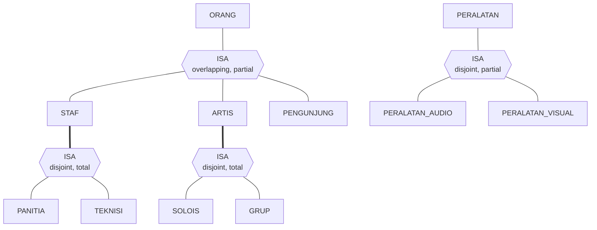
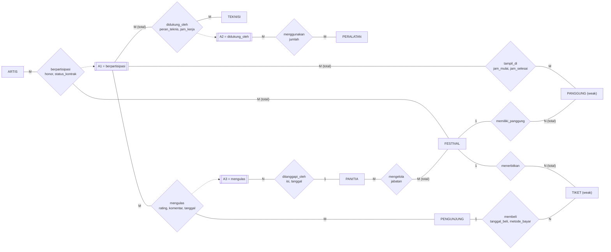

_Back to_ [[IF5101 Manajemen Data]]

# Latihan UTS IF5101 Manajemen Data — Jawaban dan Pembahasan

Soal ada di [[Latihan UTS IF5101 - Soal]]. Ini satu jawaban yang valid; desain ER sah bila konsisten dengan asumsi yang ditulis. Catatan teori terkait: [[Extended ER Features dan Isu Perancangan]], [[Mapping Cardinality, Partisipasi, dan Weak Entity Set]], [[Reduksi Relationship Set, Specialization, dan Aggregation]], [[Third Normal Form dan Perbandingan dengan BCNF]].

---

## Nomor 1 — ER Modelling

> Diagram lengkap (notasi Chen) tersedia sebagai XML draw.io: `Latihan UTS IF5101 - Jawaban No 1 (draw.io XML).xml`. Cara pakai: buka diagrams.net → **Extras → Edit Diagram** → hapus isi → tempel isi file → **OK**.

### 1.1 Daftar entity set dan atribut

| Entity set | Tipe | Atribut (key digarisbawahi dengan `*`) |
| --- | --- | --- |
| ORANG | strong | `*id_orang`, nama, tanggal_lahir, **umur** (derived), **alamat** (komposit: jalan, kota, kode_pos), **{email}** (multivalued) |
| STAF | subtype ORANG | nip (candidate key), tanggal_bergabung |
| PANITIA | subtype STAF | divisi |
| TEKNISI | subtype STAF | **{sertifikasi}** (multivalued) |
| ARTIS | subtype ORANG | nama_panggung, **{genre}** (multivalued) |
| SOLOIS | subtype ARTIS | instrumen_utama |
| GRUP | subtype ARTIS | tahun_terbentuk |
| PENGUNJUNG | subtype ORANG | poin_member |
| FESTIVAL | strong | `*id_festival`, nama_festival, tanggal_mulai, tanggal_selesai, **lama_festival** (derived), **lokasi** (komposit: venue, kota) |
| PANGGUNG | **weak** (owner FESTIVAL) | discriminator `no_panggung`, nama_panggung, kapasitas |
| TIKET | **weak** (owner FESTIVAL) | discriminator `nomor_tiket`, kategori, harga |
| PERALATAN | strong | `*kode_peralatan`, nama, merek, kondisi |
| PERALATAN_AUDIO | subtype PERALATAN | daya_watt |
| PERALATAN_VISUAL | subtype PERALATAN | resolusi |

### 1.2 Specialization / generalization

| # | Super → sub | Disjointness | Completeness | Penjelasan |
| --- | --- | --- | --- | --- |
| S1 | ORANG → {STAF, ARTIS, PENGUNJUNG} | **overlapping** | **partial** | satu orang boleh memiliki beberapa peran; ada orang tanpa peran |
| S2 | STAF → {PANITIA, TEKNISI} | **disjoint** | **total** | setiap staf pasti salah satu, tidak keduanya (garis ganda ke segitiga) |
| S3 | ARTIS → {SOLOIS, GRUP} | **disjoint** | **total** | setiap artis solois atau grup |
| S4 | PERALATAN → {AUDIO, VISUAL} | **disjoint** | **partial** | "paling banyak satu"; ada peralatan jenis lain |

Hierarki S1→S2 dan S1→S3 berjenjang dua tingkat; PANITIA, TEKNISI, SOLOIS, dan GRUP mewarisi atribut dan primary key `id_orang` dari ORANG.



### 1.3 Relationship set

| Relationship | Peserta | Cardinality | Partisipasi | Atribut |
| --- | --- | --- | --- | --- |
| **memiliki_panggung** (identifying) | FESTIVAL – PANGGUNG | 1 : N | PANGGUNG total | – |
| **menerbitkan** (identifying) | FESTIVAL – TIKET | 1 : N | TIKET total | – |
| **membeli** | PENGUNJUNG – TIKET | 1 : N | TIKET **partial** (belum terjual), PENGUNJUNG partial | tanggal_beli, metode_bayar |
| **mengelola** | PANITIA – FESTIVAL | M : N | FESTIVAL total, PANITIA partial | jabatan |
| **melapor_ke** (recursive) | PANITIA (bawahan) – PANITIA (atasan) | N : 1 | keduanya partial | – |
| **berpartisipasi** (R1) | ARTIS – FESTIVAL | M : N | FESTIVAL total, ARTIS partial | honor, status_kontrak |
| **didukung_oleh** (R2) | **A1** – TEKNISI | M : N | A1 total, TEKNISI partial | peran_teknis, jam_kerja |
| **menggunakan** (R3) | **A2** – PERALATAN | M : N | keduanya partial | jumlah |
| **tampil_di** (R4) | **A1** – PANGGUNG | M : N | A1 total, PANGGUNG partial | jam_mulai, jam_selesai |
| **mengulas** (R5) | **A1** – PENGUNJUNG | M : N | keduanya partial | rating, komentar, tanggal_ulasan |
| **ditanggapi_oleh** (R6) | **A3** – PANITIA | N : 1 | A3 partial, PANITIA partial | isi_tanggapan, tanggal_tanggapan |

### 1.4 Aggregation

| Aggregation | Membungkus | Dipakai oleh | Mengapa perlu |
| --- | --- | --- | --- |
| **A1** | relationship `berpartisipasi` (ARTIS, FESTIVAL) | R2 `didukung_oleh`, R4 `tampil_di`, R5 `mengulas` | dukungan, jadwal, dan ulasan melekat pada *pasangan* artis-festival, bukan pada artis atau festival saja |
| **A2** | relationship `didukung_oleh` (A1, TEKNISI) | R3 `menggunakan` | peralatan dipakai dalam *satu dukungan* teknisi tertentu pada partisipasi tertentu (**nested aggregation**) |
| **A3** | relationship `mengulas` (A1, PENGUNJUNG) | R6 `ditanggapi_oleh` | tanggapan melekat pada *satu ulasan* (**nested**, dan A1 dipakai bersama oleh A2 dan A3 → aggregation yang **overlapping**) |

Mengapa bukan ternary? Tanpa aggregation, `didukung_oleh` harus menjadi ternary ARTIS–FESTIVAL–TEKNISI, dan `menggunakan` quaternary; lalu relationship `berpartisipasi` menjadi redundan dengan ternary tersebut dan tidak lagi bisa menyatakan honor secara bersih bila ada partisipasi tanpa dukungan. Aggregation memperlakukan `berpartisipasi` sebagai satu unit.



Pada gambar kertas, garis putus-putus `-.->` digambar sebagai **kotak yang mengelilingi** relationship (dan peserta-pesertanya) yang diaggregasi.

### 1.5 Asumsi yang digunakan

1. Panitia dan teknisi mewarisi `id_orang` dari ORANG sebagai primary key; `nip` hanya candidate key.
2. `jenis_staf` tidak disimpan sebagai atribut; keanggotaan subtype ditentukan oleh keberadaan entity di PANITIA atau TEKNISI (user-defined membership).
3. Aggregation A1, A2, A3 diidentifikasi oleh gabungan primary key peserta relationship yang dibungkusnya.
4. `rating` bertipe bilangan bulat 1–5, `jam_mulai`/`jam_selesai` bertipe waktu.
5. Satu partisipasi boleh dijadwalkan di beberapa panggung pada hari berbeda; ER tidak menyimpan tanggal tampil terpisah (hanya jam). Bila perlu tanggal, atribut `tanggal_tampil` ditambahkan pada R4.
6. Seorang pengunjung paling banyak mengulas satu partisipasi satu kali (kombinasi A1 + pengunjung adalah key relationship `mengulas`).

### 1.6 Constraint yang tidak dapat dimodelkan dengan ER

1. `rating` ∈ [1, 5], `jam_mulai` < `jam_selesai`, `tanggal_selesai` ≥ `tanggal_mulai`, serta `tanggal_beli` tidak melewati `tanggal_selesai` festival: ER tidak punya notasi domain/check.
2. **Panggung pada jadwal harus milik festival yang sama** dengan partisipasi (R4 menghubungkan A1 dan PANGGUNG, tetapi ER tidak menyatakan kesamaan festival keduanya).
3. **Pengunjung hanya boleh mengulas festival yang tiketnya ia beli**: melibatkan jalur FESTIVAL–TIKET–PENGUNJUNG yang tidak dapat dinyatakan sebagai constraint pada R5.
4. **Panitia penanggap harus pengelola festival** terkait: butuh perbandingan jalur `ditanggapi_oleh` dengan `mengelola`.
5. Jadwal seorang artis tidak boleh bentrok (interval waktu overlap) dan atasan tidak boleh siklik pada `melapor_ke`.

---

## Nomor 2 — Reduksi ke Skema Relasional

### 2.1 Strategi mapping hierarki

| Hierarki | Strategi | Alasan |
| --- | --- | --- |
| ORANG → STAF/ARTIS/PENGUNJUNG | satu tabel per entity | overlapping & partial; ARTIS dan PENGUNJUNG dirujuk relationship |
| STAF → PANITIA/TEKNISI | **tabel subtype saja** (tanpa tabel STAF) | disjoint & total, dan STAF tidak dirujuk relationship mana pun |
| ARTIS → SOLOIS/GRUP | satu tabel per entity | ARTIS dirujuk R1; tabel ARTIS harus ada |
| PERALATAN → AUDIO/VISUAL | satu tabel per entity | partial; PERALATAN dirujuk R3 |

### 2.2 Skema relasional

Notasi: `*` = primary key (bagian dari PK), `→` = foreign key.

```
orang(*id_orang, nama, tanggal_lahir, jalan, kota, kode_pos)
email_orang(*id_orang→orang, *email)

panitia(*id_orang→orang, nip UNIQUE, tanggal_bergabung, divisi, id_atasan→panitia NULL)
teknisi(*id_orang→orang, nip UNIQUE, tanggal_bergabung)
sertifikasi_teknisi(*id_orang→teknisi, *sertifikasi)

artis(*id_orang→orang, nama_panggung)
genre_artis(*id_orang→artis, *genre)
solois(*id_orang→artis, instrumen_utama)
grup(*id_orang→artis, tahun_terbentuk)

pengunjung(*id_orang→orang, poin_member)

festival(*id_festival, nama_festival, tanggal_mulai, tanggal_selesai, venue, kota)
panggung(*id_festival→festival, *no_panggung, nama_panggung, kapasitas)
tiket(*id_festival→festival, *nomor_tiket, kategori, harga,
      id_pengunjung→pengunjung NULL, tanggal_beli NULL, metode_bayar NULL)

pengelolaan_festival(*id_panitia→panitia, *id_festival→festival, jabatan)

partisipasi(*id_artis→artis, *id_festival→festival, honor, status_kontrak)
dukungan_teknis(*id_artis, *id_festival, *id_teknisi→teknisi, peran_teknis, jam_kerja)
        (id_artis, id_festival) → partisipasi
penggunaan_peralatan(*id_artis, *id_festival, *id_teknisi, *kode_peralatan→peralatan, jumlah)
        (id_artis, id_festival, id_teknisi) → dukungan_teknis
jadwal_tampil(*id_artis, *id_festival, *no_panggung, jam_mulai, jam_selesai)
        (id_artis, id_festival) → partisipasi ;  (id_festival, no_panggung) → panggung
ulasan(*id_artis, *id_festival, *id_pengunjung→pengunjung, rating, komentar, tanggal_ulasan,
       id_panitia_penanggap→panitia NULL, isi_tanggapan NULL, tanggal_tanggapan NULL)
        (id_artis, id_festival) → partisipasi

peralatan(*kode_peralatan, nama, merek, kondisi)
peralatan_audio(*kode_peralatan→peralatan, daya_watt)
peralatan_visual(*kode_peralatan→peralatan, resolusi)
```

Atribut derived (`umur`, `lama_festival`) **tidak** disimpan; dihitung lewat query atau view.

### 2.3 Poin penting

- **Weak entity:** PK `panggung` dan `tiket` = PK owner (`id_festival`) + discriminator.
- **Aggregation:** PK relasi dari relationship atas aggregation = PK aggregation (yaitu PK relasi `partisipasi`: `id_artis, id_festival`) + PK peserta lain. Karena A2 membungkus `dukungan_teknis`, `penggunaan_peralatan` membawa **empat** kolom PK dan FK komposit tiga kolom ke `dukungan_teknis`. FK komposit ini yang menyatakan "dalam satu dukungan tertentu".
- **Relationship digabung ke tabel entity:**
  - `membeli` → kolom `id_pengunjung, tanggal_beli, metode_bayar` di `tiket` (N:1, sisi tiket partial → nullable).
  - `ditanggapi_oleh` → kolom di `ulasan` (N:1 dari A3 ke PANITIA, partial → nullable).
  - `melapor_ke` → `id_atasan` di `panitia`.
  - `memiliki_panggung` dan `menerbitkan` ikut terserap oleh PK weak entity.
- **Constraint 2 dari 1.6 terselesaikan otomatis** di relasional: `jadwal_tampil` memakai `id_festival` yang sama pada dua FK sekaligus, sehingga panggung pasti milik festival partisipasi. Ini contoh constraint yang tak bisa digambar di ER tetapi muncul dari desain kunci. Constraint 3 dan 4 tetap butuh trigger atau query validasi.

---

## Nomor 3 — SQL

### Resep berpikir (baca dulu kalau SQL masih bikin pusing)

Urutan kerja untuk **setiap** soal SQL:

1. **Kolom output dulu.** Tulis kolom yang diminta, lalu cari tabel asal tiap kolom ⇒ itu isi `FROM`/`JOIN`.
2. **Cari penghubung antar tabel.** Telusuri foreign key. Ingat: banyak relasi di sini punya **FK komposit** (`id_artis` + `id_festival`), jadi `JOIN` harus mencocokkan **semua** kolom.
3. **Filter baris dulu, baru kelompokkan.** Syarat atas nilai baris biasa → `WHERE`; syarat atas hasil agregat (`AVG`, `COUNT`, `SUM`) → `HAVING`.
4. **Ada kata "setiap/per/untuk tiap"?** ⇒ `GROUP BY` kolom itu (dan semua kolom non-agregat di `SELECT` ikut masuk).
5. Terjemahkan kata kunci:

| Kata di soal | Pola SQL |
| --- | --- |
| "untuk setiap …, hitung/total" | `GROUP BY` + `COUNT/SUM/AVG` |
| "yang rata-rata/jumlahnya minimal …" | `HAVING` |
| "belum pernah / tidak punya / tanpa" | `NOT EXISTS`, atau `LEFT JOIN … WHERE kolom_kanan IS NULL` |
| "semua festival, termasuk yang 0" | `LEFT JOIN` + `COUNT(kolom_tabel_kanan)` |
| "sekaligus A **dan** B" | `INTERSECT`, atau dua `IN`, atau `JOIN` |
| "di atas rata-rata **kelompoknya**" | subquery **berkorelasi** pada kolom kelompok |
| "tampil di **semua** …" | `NOT EXISTS (… NOT EXISTS (…))` (division) |

Jebakan yang paling sering memakan nilai: (i) `COUNT(*)` pada `LEFT JOIN` menghitung baris palsu ⇒ pakai `COUNT(kolom_kanan)`; (ii) lupa satu kolom pada `JOIN` komposit sehingga baris berlipat; (iii) `NOT IN` dengan subquery yang bisa menghasilkan `NULL` ⇒ gunakan `NOT EXISTS`; (iv) kolom non-agregat tidak masuk `GROUP BY`.

### Jawaban

**a.** (join 3 tabel + filter + order)
```sql
SELECT a.nama_panggung, f.nama_festival, p.honor
FROM   partisipasi p
JOIN   artis a    ON a.id_orang    = p.id_artis
JOIN   festival f ON f.id_festival = p.id_festival
WHERE  p.honor >= 10000000
ORDER  BY p.honor DESC;
```
Sumber kolom: `nama_panggung` ← `artis`, `nama_festival` ← `festival`, `honor` ← `partisipasi`; penghubungnya dua FK di `partisipasi`.

**b.** (agregasi per kelompok)
```sql
SELECT f.nama_festival,
       COUNT(t.id_pengunjung) AS tiket_terjual,
       SUM(t.harga)           AS total_pendapatan
FROM   festival f
JOIN   tiket t ON t.id_festival = f.id_festival
WHERE  t.id_pengunjung IS NOT NULL
GROUP  BY f.id_festival, f.nama_festival;
```
"Terjual" = `id_pengunjung` tidak NULL, jadi filter ada di `WHERE` (filter baris, bukan agregat). Festival yang tidak punya tiket terjual tidak muncul; bila diminta tetap muncul, ubah menjadi `LEFT JOIN` dengan syarat `AND t.id_pengunjung IS NOT NULL` pindah ke `ON`.

**c.** (agregat + `HAVING`)
```sql
SELECT a.nama_panggung, f.nama_festival, AVG(u.rating) AS rata_rating
FROM   ulasan u
JOIN   artis a    ON a.id_orang    = u.id_artis
JOIN   festival f ON f.id_festival = u.id_festival
GROUP  BY a.id_orang, a.nama_panggung, f.id_festival, f.nama_festival
HAVING AVG(u.rating) >= 4.5
ORDER  BY rata_rating DESC;
```

**d.** (outer join)
```sql
SELECT f.id_festival, f.nama_festival, COUNT(u.id_pengunjung) AS jumlah_ulasan
FROM   festival f
LEFT   JOIN ulasan u ON u.id_festival = f.id_festival
GROUP  BY f.id_festival, f.nama_festival
ORDER  BY jumlah_ulasan;
```
`COUNT(u.id_pengunjung)` menghasilkan 0 untuk festival tanpa ulasan karena kolom sisi kanan berisi NULL; `COUNT(*)` akan salah memberi 1. Varian "hanya festival tanpa ulasan": tambahkan `HAVING COUNT(u.id_pengunjung) = 0`, atau `WHERE NOT EXISTS (SELECT 1 FROM ulasan u WHERE u.id_festival = f.id_festival)`.

**e.** (irisan)
```sql
SELECT o.id_orang, o.nama
FROM   orang o
WHERE  o.id_orang IN (SELECT id_orang FROM panitia)
  AND  o.id_orang IN (SELECT id_orang FROM pengunjung);
```
Alternatif:
```sql
SELECT o.id_orang, o.nama
FROM   orang o
JOIN  (SELECT id_orang FROM panitia
       INTERSECT
       SELECT id_orang FROM pengunjung) x ON x.id_orang = o.id_orang;
```

**f.** (subquery berkorelasi)
```sql
SELECT a.nama_panggung, f.nama_festival, p.honor
FROM   partisipasi p
JOIN   artis a    ON a.id_orang    = p.id_artis
JOIN   festival f ON f.id_festival = p.id_festival
WHERE  p.honor > (SELECT AVG(p2.honor)
                  FROM   partisipasi p2
                  WHERE  p2.id_festival = p.id_festival);
```
Subquery dihitung ulang untuk **tiap baris** `p` karena merujuk `p.id_festival`; itulah arti "rata-rata pada festival yang sama".

**g.** (division: "untuk semua" = tidak ada panggung festival itu yang tidak dipakai artis tersebut)
```sql
SELECT a.id_orang, a.nama_panggung
FROM   artis a
WHERE  NOT EXISTS (
         SELECT 1
         FROM   panggung p
         JOIN   festival f ON f.id_festival = p.id_festival
         WHERE  f.nama_festival = 'NusaFest 2026'
           AND  NOT EXISTS (
                  SELECT 1
                  FROM   jadwal_tampil j
                  WHERE  j.id_artis    = a.id_orang
                    AND  j.id_festival = p.id_festival
                    AND  j.no_panggung = p.no_panggung));
```
Cara membaca dari luar ke dalam: "artis a, sehingga tidak ada panggung p di NusaFest 2026, sehingga tidak ada jadwal j milik a di panggung p". Bila festival tidak punya panggung, semua artis lolos (vacuous truth); tambahkan `EXISTS` bila tidak diinginkan.

**h.** (`UPDATE` dengan subquery)
```sql
UPDATE partisipasi p
SET    honor = honor * 1.10
WHERE  (SELECT AVG(u.rating)
        FROM   ulasan u
        WHERE  u.id_artis    = p.id_artis
          AND  u.id_festival = p.id_festival) >= 4.5;
```
Partisipasi tanpa ulasan menghasilkan `AVG` = NULL sehingga perbandingannya *unknown* dan tidak ikut di-update.

---

## Nomor 4 — Normalisasi

### 1. Apakah relasi yang baik?

**Tidak baik.** Pada isi relasi:

- **Redundansi:** `nama`, `id_divisi`, `nama_divisi`, `gaji` T01 muncul dua kali, T02 dua kali; `nama_divisi = 'Audio'` berulang untuk T01 dan T03.
- **Nilai NULL:** T05 belum mengikuti pelatihan sehingga `judul_pelatihan` NULL. Padahal `judul_pelatihan` bagian dari key; ini melanggar *entity integrity*. `tanggal_selesai` NULL pada T02 bermakna "belum selesai", pada T05 bermakna "tidak berlaku" — maknanya ambigu.
- **Anomali:**
  - *Update:* mengubah `gaji` T01 harus mengubah dua baris; mengganti `nama_divisi` "Audio" harus mengubah semua baris D1.
  - *Insert:* teknisi baru yang belum ikut pelatihan atau divisi baru tanpa teknisi tidak dapat dicatat tanpa NULL pada bagian key.
  - *Delete:* menghapus baris T04 (satu-satunya baris D3) ikut menghilangkan informasi bahwa D3 = Rigging.

### 2. Functional dependency

```
F1: id_teknisi -> nama, id_divisi, gaji
F2: id_divisi -> nama_divisi
F3: id_teknisi, judul_pelatihan -> tanggal_selesai
```

Turunan: `id_teknisi → nama_divisi` (transitif lewat F1 lalu F2).

**`gaji → id_divisi`: tidak boleh** dinyatakan sebagai FD. FD adalah constraint pada *semua instance legal* yang ditentukan oleh **semantik**, bukan oleh isi relasi saat ini. Secara semantik, dua teknisi berbeda divisi bisa saja kebetulan bergaji sama; instance di atas hanya kebetulan sesuai. Satu contoh yang melanggar sudah cukup menolak sebuah FD, tetapi *tidak ada* jumlah contoh yang cukup untuk membuktikannya.

**`nama → id_teknisi`: tidak berlaku**, dan ini dapat dibuktikan dari isi: Raka muncul sebagai T01 dan T04 (dua teknisi berbeda bernama sama). Karena semantik juga mengizinkan nama kembar, FD ini ditolak dua kali.

### 3. Candidate key

Atribut yang tidak pernah muncul di sisi kanan F: `id_teknisi`, `judul_pelatihan` ⇒ keduanya harus ada di setiap key. Closure `{id_teknisi, judul_pelatihan}+`:

1. mulai: `id_teknisi, judul_pelatihan`
2. F1 ⇒ tambah `nama, id_divisi, gaji`
3. F2 (karena `id_divisi` sudah ada) ⇒ tambah `nama_divisi`
4. F3 ⇒ tambah `tanggal_selesai`

Hasil = semua atribut ⇒ superkey, dan minimal karena kedua atribut wajib. **Candidate key tunggal: `{id_teknisi, judul_pelatihan}`.**

### 4. Bentuk normal

Semua atribut atomik dan relasi memiliki key ⇒ **1NF**. F1 adalah **partial dependency** (`id_teknisi` hanya sebagian dari key menentukan `nama, id_divisi, gaji`) ⇒ **bukan 2NF**. Jadi bentuk normal tertinggi: **1NF**. (F2 adalah transitive dependency yang juga akan melanggar 3NF, tetapi pelanggaran 2NF muncul lebih dulu.)

### 5. Dekomposisi `R1`, `R2`

**a.**
- **Lossless:** `R1 ∩ R2 = {id_teknisi}`, dan `id_teknisi → id_teknisi, nama, id_divisi, nama_divisi, gaji` (via F1+F2) ⇒ `id_teknisi` adalah superkey `R1`. Kondisi lossless terpenuhi, sehingga `R1 ⋈ R2` = relasi asal tanpa tuple palsu.
- **Dependency preserving:** F1 dan F2 seluruh atributnya ada di `R1`; F3 ada di `R2`. Semua FD dapat ditegakkan tanpa join ⇒ **preserving**.

**b.**
- `R2`: key `{id_teknisi, judul_pelatihan}`, satu-satunya FD F3 dengan ruas kiri superkey ⇒ **BCNF**.
- `R1`: key `id_teknisi`. F1 aman (ruas kiri key). Namun **F2** `id_divisi → nama_divisi`: `id_divisi` bukan superkey dan `nama_divisi` bukan atribut prime ⇒ **transitive dependency**. Maka `R1` berada di **2NF** (tidak 3NF, tidak BCNF).

### 6. Dekomposisi sampai BCNF

`R1` dipecah berdasarkan F2:

- `R11(id_teknisi, nama, id_divisi, gaji)` — key `id_teknisi`, FD: F1 ⇒ BCNF
- `R12(id_divisi, nama_divisi)` — key `id_divisi`, FD: F2 ⇒ BCNF
- `R2(id_teknisi, judul_pelatihan, tanggal_selesai)` — BCNF

Lossless: `R11 ∩ R12 = {id_divisi}` adalah key `R12`. Dependency preserving: F1 di `R11`, F2 di `R12`, F3 di `R2`. Hasil ini sama dengan struktur tabel `teknisi`, `divisi`, dan `dukungan/pelatihan` yang akan Anda turunkan dari ER.

### 7. Dekomposisi usulan mahasiswa

`Q1(id_teknisi, nama, id_divisi, nama_divisi)` dan `Q2(nama, gaji, judul_pelatihan, tanggal_selesai)`; irisan `{nama}`.

- **Bukan lossless:** `nama` bukan superkey `Q1` (Raka muncul sebagai T01 dan T04) maupun `Q2`.
- **Isi:** `Q1` memiliki 5 tuple; `Q2` memiliki 7 tuple. Join pada `nama`: Raka (2 tuple Q1 × 3 tuple Q2 = 6), Sinta (1×2 = 2), Dimas (1×1 = 1), Laras (1×1 = 1) ⇒ **10 tuple** vs 7 asal ⇒ **3 tuple palsu**:
  - (T01, Raka, D1, Audio, **10.000.000**, Rigging Dasar, 2026-05-20) — T01 tidak pernah ikut Rigging Dasar
  - (T04, Raka, D3, Rigging, **9.000.000**, Mixing Dasar, 2026-03-10)
  - (T04, Raka, D3, Rigging, **9.000.000**, Keselamatan Panggung, 2026-04-02)
- **Bukan dependency preserving:** F2 masih utuh di `Q1`. Namun F1 terpecah (`gaji` di `Q2` tidak punya `id_teknisi`) dan F3 terpecah (`id_teknisi` hanya di `Q1`, `judul_pelatihan` hanya di `Q2`) ⇒ **F1 dan F3 hilang**.

Pelajaran: atribut penghubung dalam dekomposisi harus berupa key; memilih `nama` (bukan unik) adalah kesalahan klasik.

### 8. `Layanan(id_pengunjung, id_festival, id_panitia)`

- **Candidate key:** `{id_pengunjung, id_festival}` (closure memuat `id_panitia`) dan `{id_pengunjung, id_panitia}` (via `id_panitia → id_festival`). Semua atribut prime.
- **BCNF?** **Tidak.** `id_panitia → id_festival` memiliki ruas kiri yang bukan superkey.
- **3NF?** **Ya.** Untuk `id_panitia → id_festival`, `id_festival` terkandung dalam candidate key `{id_pengunjung, id_festival}` (kondisi ketiga 3NF); FD satunya ruas kirinya superkey.
- **Dekomposisi BCNF:** `(id_panitia, id_festival)` dan `(id_pengunjung, id_panitia)`. FD **`id_pengunjung, id_festival → id_panitia` hilang** karena atributnya tersebar di dua relasi ⇒ tidak dependency preserving. Inilah trade-off BCNF vs 3NF.

### Catatan atas contoh jawaban dosen (soal serupa `EMPLOYEE2`)

Beberapa bagian contoh jawaban perlu dipakai dengan hati-hati karena bisa menyesatkan:

1. **1NF tidak berbicara soal duplikat nilai primary key.** 1NF = semua atribut atomik (dan relasi punya key). Duplikat pada kolom yang *dideklarasikan* sebagai primary key berarti **kuncinya salah dipilih / instance melanggar constraint**, bukan relasi yang "melanggar 1NF". Pada `EMPLOYEE2`, dengan key yang benar `{Emp_ID, Course_Title}` relasinya **1NF namun bukan 2NF** karena `Emp_ID → Name, Dept_Name, Salary` adalah partial dependency. Lebih aman menjawab dengan struktur ini: *sebutkan key → cek 1NF → cek partial dependency (2NF) → cek transitive (3NF) → cek ruas kiri superkey (BCNF)*.
2. **Alasan "lossless karena bisa di-join kembali" itu mengulang definisi**, bukan alasan. Alasan yang diterima: irisan atribut kedua relasi adalah **superkey** salah satunya (di sini `Emp_ID` adalah key `R1`).
3. Cara menyatakan BCNF dengan merunut atomik → 2NF → 3NF → BCNF sudah benar, tetapi pastikan *tiap FD* diperiksa satu per satu terhadap relasi hasil, terutama FD transitif seperti pada `R1` di nomor 5b di atas (yang menjadikannya hanya 2NF, bukan BCNF).

---

## Rubrik Singkat untuk Self-Check

| Nomor | Hal yang dicek |
| --- | --- |
| 1 | 4 hierarki dengan constraint benar; 2 weak entity + identifying relationship; atribut komposit/multivalued/derived bertanda; 3 aggregation (A1 dipakai lebih dari satu relationship, A2 dan A3 nested); cardinality dan total/partial; ≥ 4 constraint non-ER disebut |
| 2 | strategi ISA beralasan; PK aggregation-based benar (4 kolom di `penggunaan_peralatan`); relationship N:1 digabung; derived tidak disimpan |
| 3 | `JOIN` komposit lengkap; `WHERE` vs `HAVING` tepat; `LEFT JOIN` + `COUNT(kolom_kanan)`; subquery berkorelasi; `NOT EXISTS` ganda; subquery di `UPDATE` |
| 4 | anomali dirujuk ke isi tabel; FD dibedakan dari kebetulan instance; closure tertulis; 1NF vs 2NF benar; lossless dibuktikan lewat irisan = key; tuple palsu dihitung; kasus 3NF-bukan-BCNF |
